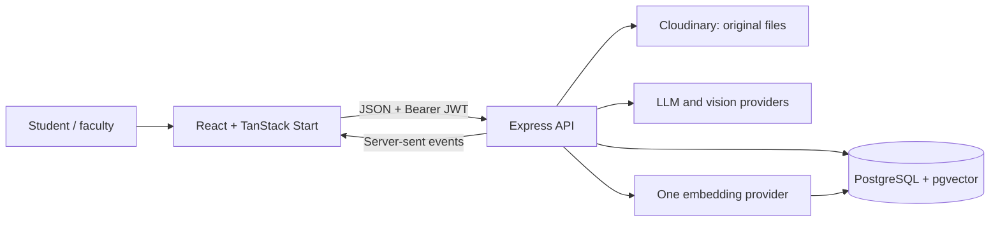

# CampusBrain

**A focused workspace for exam preparation: past papers, active recall, and a plan for what comes next.**

CampusBrain brings course resources and study tools together. Students browse original papers, find past questions by topic, practise with quizzes and flashcards, and plan revision around their syllabus and exam dates.

## What you can do

| Area           | What it provides                                                                              |
| -------------- | --------------------------------------------------------------------------------------------- |
| Paper library  | Public browsing by branch, semester and subject; original PDF or image downloads              |
| Topic search   | Keyword, alias and vector retrieval of individual past questions with source papers and years |
| Syllabus       | Course units and topics; a starting point for search and revision                             |
| Quizzes        | AI-generated questions, server-side scoring, explanations and attempt history                 |
| Flashcards     | Manual or generated decks with SM-2 review scheduling                                         |
| Study plans    | Daily time budgets, exam deadlines, session completion and catch-up planning                  |
| Study groups   | Invite codes, shared plans and member progress                                                |
| AI Coach       | Streaming conversations with tools for retrieval, practice and mock-paper generation          |
| Administration | Role-protected catalogue maintenance and resource uploads                                     |

The original interface and visual design are retained, including the animated landing page, paper library, study tools and admin panel.

## Architecture at a glance



- **Frontend:** React 19, TypeScript, TanStack Router/Start, Tailwind CSS, Radix UI.
- **Backend:** Express, TypeScript, Prisma, Zod and JWT authentication.
- **Retrieval:** PostgreSQL with pgvector, stored question/chunk embeddings and cached topic profiles.
- **External services:** Cloudinary for files; configurable AI providers for generation, extraction and embeddings.

See [architecture and diagrams](docs/architecture.md) for the data model, ingestion pipeline, retrieval flow and authentication sequence.

## Run locally

### Prerequisites

- Node.js **22.12 or later** (Node 24 is suitable) and npm. The backend Docker image uses Node 22.
- PostgreSQL with the `vector` extension available.
- Cloudinary credentials for uploads.
- AI keys for the features you intend to use. Browsing and manual study features do not require AI keys.

This repository contains two independent npm projects. Start **both** for a working application.

### 1. Configure and start the API

```sh
cd backend
npm ci
```

Copy `backend/.env.example` to `backend/.env` and fill in the required values. In PowerShell:

```powershell
Copy-Item .env.example .env
```

Set `DATABASE_URL` and `DIRECT_URL` to your database connections. Use the direct, non-pooler connection for `DIRECT_URL`. Generate two different JWT secrets of at least 32 characters; never use the sample values in a deployment.

```sh
npm run db:generate
npm run db:migrate:deploy
npm run db:seed
npm run dev
```

The API starts at [localhost:4000](http://localhost:4000/api/health).

The seed is optional. It creates demo accounts and branches. Subjects are discovered from an optional root `OUTPUT/<BRANCH>/<SEMX>/<Subject_Name>.pdf` directory, which is **not included**. A fresh checkout may therefore have no subjects; an admin can add them in the catalogue.

Production seeding requires explicit `SEED_ADMIN_PASSWORD` and `SEED_TEACHER_PASSWORD` values. Keep account credentials private.

### 2. Start the frontend in a second terminal

```sh
cd frontend
npm ci
```

Copy `frontend/.env.example` to `frontend/.env`. Set:

```env
VITE_API_URL=http://localhost:4000
```

```sh
npm run dev -- --port 3000
```

Open [localhost:3000](http://localhost:3000). If you choose another port, add that exact origin to the backend's `CORS_ORIGINS`. Restart the relevant process after changing environment variables.

### 3. Make the workspace yours

1. Create a student account and sign in.
2. Choose your branch, semester and enrolled subjects in **My subjects & profile**.
3. Explore papers and the syllabus.
4. Generate a quiz, create a flashcard deck, or build a study plan.
5. Use **Overview** to return to your progress.

## Configuration

| Variable                                                               | Purpose                                                                     |
| ---------------------------------------------------------------------- | --------------------------------------------------------------------------- |
| `DATABASE_URL`, `DIRECT_URL`                                           | Required Prisma database connections                                        |
| `JWT_ACCESS_SECRET`, `JWT_REFRESH_SECRET`                              | Required, distinct signing secrets; at least 32 characters                  |
| `JWT_ACCESS_EXPIRES_IN`, `JWT_REFRESH_EXPIRES_IN`                      | Positive duration such as `15m` / `7d`                                      |
| `CLOUDINARY_CLOUD_NAME`, `CLOUDINARY_API_KEY`, `CLOUDINARY_API_SECRET` | Required storage configuration                                              |
| `BOT_BASE_URL`                                                         | Required URL for the external Streamlit paper-chat integration              |
| `FRONTEND_URL`                                                         | Primary allowed browser origin; default `http://localhost:3000`             |
| `CORS_ORIGINS`                                                         | Comma-separated additional **exact origins**, including preview deployments |
| `GROQ_API_KEY`, `OPENAI_API_KEY`                                       | Optional quiz/flashcard generation keys; Groq is tried first                |
| `GEMINI_API_KEY`                                                       | Optional embeddings, topic expansion, vision and agent provider key         |
| `HUGGINGFACE_API_KEY`                                                  | Embeddings when Gemini is not configured                                    |
| `PORT`, `NODE_ENV`                                                     | API port and environment                                                    |

Embeddings use Gemini `gemini-embedding-001` when its key is configured, otherwise Hugging Face `BAAI/bge-base-en-v1.5`. Both produce 768-dimensional vectors, but their vector spaces are incompatible: **re-index all resources and syllabus chunks when changing providers**. Topic-profile cache entries record their model and are rebuilt on mismatch. Topic alias generation uses Gemini; search degrades when profile expansion or embeddings are unavailable.

No AI keys means generated quizzes and flashcards return HTTP 503. The application does not save generic placeholder content as educational material. Provider quotas and availability are external constraints.

## Checks and development

Run these inside `backend/`:

```sh
npm run typecheck
npm run lint
npm test
npm run build
```

Run these inside `frontend/`:

```sh
npm run typecheck
npm run lint
npm run build
```

The regression suite covers request validation, authentication, refresh consumption, upload signatures, retrieval ranking, exam matching, scheduling and analytics. HTTP tests use fake credentials and mocked database methods; they do not contact your database or AI providers. Live PostgreSQL concurrency and external-service integration need separate staging checks.

CI runs both packages' checks. See [contributing](CONTRIBUTING.md) for repository conventions.

The [feature review](docs/feature-audit.md) records the efficiency changes, regression coverage and remaining staging checks, including the RAG/PYQ Finder.

## Operations and maintenance

```sh
# From the repository root: API container only, external database
docker compose up --build
```

Migrations are an explicit deployment step; the container does not apply them at startup. Build the frontend separately with `npm run build`; its current Nitro target is Vercel. The API's `/api/health` endpoint is a process liveness check, not a database or AI readiness check.

| Command (in backend)                    | Purpose                                                             |
| --------------------------------------- | ------------------------------------------------------------------- |
| `npm run db:migrate:deploy`             | Apply committed migrations without a development reset              |
| `npm run db:studio`                     | Inspect local database records                                      |
| `npx tsx scripts/backfill.ts`           | Re-index resource chunks                                            |
| `npx tsx scripts/backfillQuestions.ts`  | Re-extract/index individual questions                               |
| `npx tsx scripts/buildTopicProfiles.ts` | Precompute cached topic profiles                                    |
| `npx tsx scripts/bulkUpload.ts`         | Import a prepared paper collection; inspect its configuration first |

Read the [operations guide](docs/operations.md) before running bulk imports or re-indexing a deployment.

## Repository map

```text
frontend/src/
  routes/                 File-based pages and shared layout
  components/campus/      Navigation, sign-in, upload and paper results
  components/ui/          Reusable Radix-based UI primitives
  lib/                    API client, auth, shared state and PDF export
backend/
  src/routes/             HTTP endpoints grouped by feature
  src/lib/                Retrieval, ingestion, AI, planning and security helpers
  src/middleware/         Authentication and client-safe error handling
  prisma/                 Schema, migrations and seed
  scripts/                Import and indexing maintenance
  tests/                  Regression suite
docs/                     Architecture, operations and original project report
```

The [original academic project report](docs/project-report.md) is retained as historical context. Use this README and the current source for setup and operational behavior.

## Current limitations

- Ingestion runs inside the API process after upload; it is not a durable job queue. Interrupted indexing requires a backfill.
- Tokens are stored in browser local storage. Protect against XSS and review cookie-based session storage before a sensitive deployment.
- Rate limits and embedding caches are process-local; multiple replicas require shared infrastructure for consistent quotas.
- AI output can be incorrect. Review it against the syllabus and original papers.
- This repository has no declared open-source license. Confirm usage and redistribution rights with its owner.
