# CampusBrain

**A focused workspace for exam preparation: past papers, active recall, and a plan for what comes next.**

CampusBrain brings course resources and study tools together. Students browse original papers, find past questions by topic, practise with quizzes and flashcards, and plan revision around their syllabus and exam dates.


## Contents

- [Features](#what-you-can-do)
- [Architecture overview](#architecture-at-a-glance)
- [Local setup](#run-locally)
- [Configuration](#configuration)
- [Checks and development](#checks-and-development)
- [Operations and maintenance](#operations-and-maintenance)
- [Repository map](#repository-map)
- [Current limitations](#current-limitations)
- [Roles and permissions](#roles-and-permissions)
- [Architecture details](#architecture-details)
- [Deployment and operations guide](#deployment-and-operations-guide)
- [Contributing](#contributing)
- [Frontend routing conventions](#frontend-routing-conventions)
- [Feature review and efficiency changes](#feature-review-and-efficiency-changes)
- [Project analysis and design report](#project-analysis-and-design-report)

## What you can do

| Area           | What it provides                                                                              |
| -------------- | --------------------------------------------------------------------------------------------- |
| Paper library  | Public browsing by branch, semester and subject; original PDF or image downloads              |
| Topic search   | Keyword, alias and vector retrieval of individual past questions with source papers and years |
| Syllabus       | Course units and topics; a starting point for search and revision                             |
| Quizzes        | AI-generated questions, server-side scoring, explanations and attempt history                 |
| Flashcards     | Manual or generated decks with SM-2 review scheduling                                         |
| Study plans    | Daily time budgets, exam deadlines, session completion and catch-up planning                  |
| Study groups   | Invite codes, shared plans and member progress                                                |
| AI Coach       | Streaming conversations with tools for retrieval, practice and mock-paper generation          |
| Administration | Role-protected catalogue maintenance and resource uploads                                     |

The original interface and visual design are retained, including the animated landing page, paper library, study tools and admin panel.

## Architecture at a glance

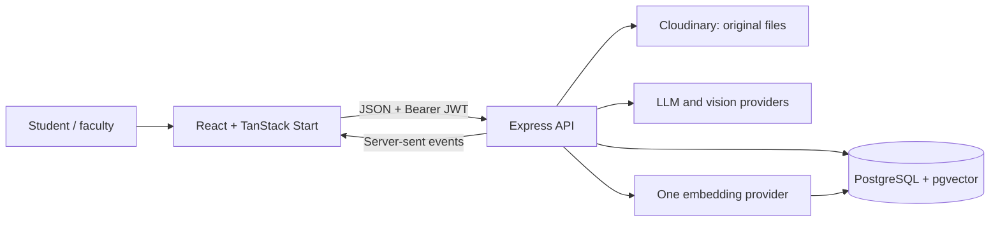

- **Frontend:** React 19, TypeScript, TanStack Router/Start, Tailwind CSS, Radix UI.
- **Backend:** Node.js, Express, TypeScript, Prisma, Zod and JWT authentication.
- **Retrieval:** PostgreSQL with pgvector, stored question/chunk embeddings and cached topic profiles.
- **External services:** Cloudinary for files; configurable AI providers for generation, extraction and embeddings.

See [architecture details](#architecture-details) for the data model, ingestion pipeline, retrieval flow and authentication sequence.

## Run locally

### Prerequisites

- Node.js **22.12 or later** (Node 24 is suitable) and npm. The backend Docker image uses Node 22.
- PostgreSQL with the `vector` extension available.
- Cloudinary credentials for uploads.
- AI keys for the features you intend to use. Browsing and manual study features do not require AI keys.

This repository contains two independent npm projects. Start **both** for a working application.

### 1. Configure and start the API

```sh
cd backend
npm ci
```

Copy `backend/.env.example` to `backend/.env` and fill in the required values. In PowerShell:

```powershell
Copy-Item .env.example .env
```

Set `DATABASE_URL` and `DIRECT_URL` to your database connections. Use the direct, non-pooler connection for `DIRECT_URL`. Generate two different JWT secrets of at least 32 characters; never use the sample values in a deployment.

```sh
npm run db:generate
npm run db:migrate:deploy
npm run db:seed
npm run dev
```

The API starts at [localhost:4000](http://localhost:4000/api/health).

The seed is optional. It creates demo accounts and branches. Subjects are discovered from an optional root `OUTPUT/<BRANCH>/<SEMX>/<Subject_Name>.pdf` directory, which is **not included**. A fresh checkout may therefore have no subjects; an admin can add them in the catalogue.

Production seeding requires explicit `SEED_ADMIN_PASSWORD` and `SEED_TEACHER_PASSWORD` values. Keep account credentials private.

### 2. Start the frontend in a second terminal

```sh
cd frontend
npm ci
```

Copy `frontend/.env.example` to `frontend/.env`. Set:

```env
VITE_API_URL=http://localhost:4000
```

```sh
npm run dev -- --port 3000
```

Open [localhost:3000](http://localhost:3000). If you choose another port, add that exact origin to the backend's `CORS_ORIGINS`. Restart the relevant process after changing environment variables.

### 3. Make the workspace yours

1. Create a student account and sign in.
2. Choose your branch, semester and enrolled subjects in **My subjects & profile**.
3. Explore papers and the syllabus.
4. Generate a quiz, create a flashcard deck, or build a study plan.
5. Use **Overview** to return to your progress.

## Configuration

| Variable                                                               | Purpose                                                                     |
| ---------------------------------------------------------------------- | --------------------------------------------------------------------------- |
| `DATABASE_URL`, `DIRECT_URL`                                           | Required Prisma database connections                                        |
| `JWT_ACCESS_SECRET`, `JWT_REFRESH_SECRET`                              | Required, distinct signing secrets; at least 32 characters                  |
| `JWT_ACCESS_EXPIRES_IN`, `JWT_REFRESH_EXPIRES_IN`                      | Positive duration such as `15m` / `7d`                                      |
| `CLOUDINARY_CLOUD_NAME`, `CLOUDINARY_API_KEY`, `CLOUDINARY_API_SECRET` | Required storage configuration                                              |
| `BOT_BASE_URL`                                                         | Required URL for the external Streamlit paper-chat integration              |
| `FRONTEND_URL`                                                         | Primary allowed browser origin; default `http://localhost:3000`             |
| `CORS_ORIGINS`                                                         | Comma-separated additional **exact origins**, including preview deployments |
| `GROQ_API_KEY`, `OPENAI_API_KEY`                                       | Optional quiz/flashcard generation keys; Groq is tried first                |
| `GEMINI_API_KEY`                                                       | Optional embeddings, topic expansion, vision and agent provider key         |
| `HUGGINGFACE_API_KEY`                                                  | Embeddings when Gemini is not configured                                    |
| `PORT`, `NODE_ENV`                                                     | API port and environment                                                    |

Embeddings use Gemini `gemini-embedding-001` when its key is configured, otherwise Hugging Face `BAAI/bge-base-en-v1.5`. Both produce 768-dimensional vectors, but their vector spaces are incompatible: **re-index all resources and syllabus chunks when changing providers**. Topic-profile cache entries record their model and are rebuilt on mismatch. Topic alias generation uses Gemini; search degrades when profile expansion or embeddings are unavailable.

No AI keys means generated quizzes and flashcards return HTTP 503. The application does not save generic placeholder content as educational material. Provider quotas and availability are external constraints.

## Checks and development

Run these inside `backend/`:

```sh
npm run typecheck
npm run lint
npm test
npm run build
```

Run these inside `frontend/`:

```sh
npm run typecheck
npm run lint
npm run build
```

The regression suite covers request validation, authentication, refresh consumption, upload signatures, retrieval ranking, exam matching, scheduling and analytics. HTTP tests use fake credentials and mocked database methods; they do not contact your database or AI providers. Live PostgreSQL concurrency and external-service integration need separate staging checks.

CI runs both packages' checks. See [contributing](#contributing) for repository conventions.

The [feature review](#feature-review-and-efficiency-changes) records the efficiency changes, regression coverage and remaining staging checks, including the RAG/PYQ Finder.

## Operations and maintenance

```sh
# From the repository root: API container only, external database
docker compose up --build
```

Migrations are an explicit deployment step; the container does not apply them at startup. Build the frontend separately with `npm run build`; its current Nitro target is Vercel. The API's `/api/health` endpoint is a process liveness check, not a database or AI readiness check.

| Command (in backend)                    | Purpose                                                             |
| --------------------------------------- | ------------------------------------------------------------------- |
| `npm run db:migrate:deploy`             | Apply committed migrations without a development reset              |
| `npm run db:studio`                     | Inspect local database records                                      |
| `npx tsx scripts/backfill.ts`           | Re-index resource chunks                                            |
| `npx tsx scripts/backfillQuestions.ts`  | Re-extract/index individual questions                               |
| `npx tsx scripts/buildTopicProfiles.ts` | Precompute cached topic profiles                                    |
| `npx tsx scripts/bulkUpload.ts`         | Import a prepared paper collection; inspect its configuration first |

Read the [operations guide](#deployment-and-operations-guide) before running bulk imports or re-indexing a deployment.

## Repository map

```text
frontend/src/
  routes/                 File-based pages and shared layout
  components/campus/      Navigation, sign-in, upload and paper results
  components/ui/          Reusable Radix-based UI primitives
  lib/                    API client, auth, shared state and PDF export
backend/
  src/routes/             HTTP endpoints grouped by feature
  src/lib/                Retrieval, ingestion, AI, planning and security helpers
  src/middleware/         Authentication and client-safe error handling
  prisma/                 Schema, migrations and seed
  scripts/                Import and indexing maintenance
  tests/                  Regression suite
README.md                 Complete project documentation
docs/                     Compatibility links to README sections
```

The full analysis and design report is included [below](#project-analysis-and-design-report), together with maintained setup and operational guidance.

## Current limitations

- Ingestion runs inside the API process after upload; it is not a durable job queue. Interrupted indexing requires a backfill.
- Tokens are stored in browser local storage. Protect against XSS and review cookie-based session storage before a sensitive deployment.
- Rate limits and embedding caches are process-local; multiple replicas require shared infrastructure for consistent quotas.
- AI output can be incorrect. Review it against the syllabus and original papers.
- This repository has no declared open-source license. Confirm usage and redistribution rights with its owner.

## Roles and permissions

The API enforces roles independently of which controls the UI displays.

| Action | Student | Teacher | Admin |
| --- | --- | --- | --- |
| Browse the public catalogue and papers | Yes | Yes | Yes |
| Use personal study tools and join/create groups | Yes | Yes | Yes |
| Upload resources | No | Yes | Yes |
| Delete resources | No | Own uploads | Any upload |
| Create syllabi and add, edit or delete their units | No | Yes | Yes |
| Delete an entire syllabus | No | No | Yes |
| Manage branches and subjects | No | No | Yes |
| Create accounts with assigned roles | No | No | Yes |

Personal study records are scoped to their owner. Group actions depend on membership or group ownership. Teacher syllabus edits currently have no creator or assigned-course restriction: teachers can modify units in any syllabus.

Passwords are hashed with bcrypt. Refresh tokens can be revoked; changing a password alone does not invalidate existing access JWTs. With the default configuration, access tokens expire after 15 minutes. Keep all login details outside this document and source control.


## Architecture details

CampusBrain separates a server-rendered React frontend from an Express API. PostgreSQL stores accounts, academic structure, study activity and retrieval vectors; Cloudinary stores original papers. Route authorization is enforced by the API. Client-side role visibility is only a navigation convenience.

### Boundaries

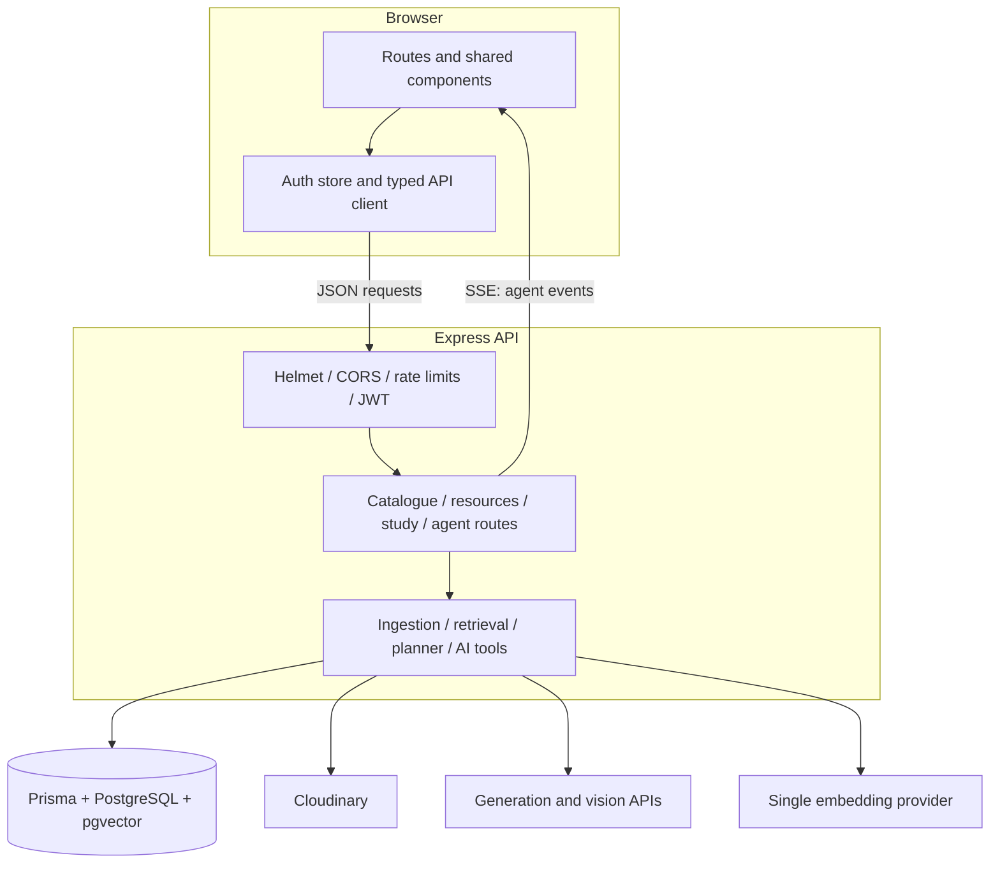

The browser receives only public resource metadata or data authorized for its user. Teachers may upload and delete their own resources; admins can manage the catalogue and delete any resource. Personal study records belong to a user. Group routes verify membership or ownership before group actions.

### Ingestion: from original file to searchable evidence

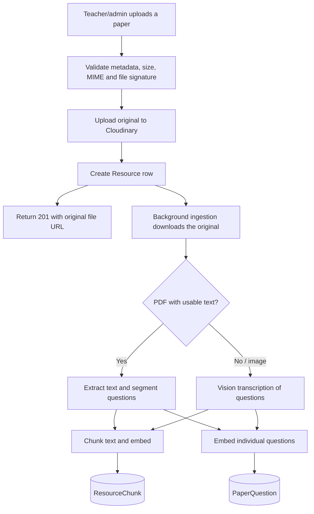

Supported new uploads are PDF, PNG, JPEG and WebP, up to 25 MB. Timetable PDFs have a separate 10 MB limit. Signature checks reject unsupported or disguised content before storage; they do not prove a file is structurally valid or malware-free.

If the database insert fails after upload, the route attempts to remove the orphaned Cloudinary asset and logs a failed cleanup. Cloud storage and PostgreSQL cannot participate in one atomic transaction.

Text chunks serve retrieval-augmented generation (RAG); individual questions serve topic-wise PYQ search. Syllabus items have their own overview/topic chunks. Embeddings are computed before replacing indexed records, and indexed replacements use database transactions.

Background work is not durable: a successful upload means the original was saved, not that extraction and indexing completed. Re-run the maintenance scripts after interruptions and inspect ingestion logs.

### Retrieval: relevance before generation

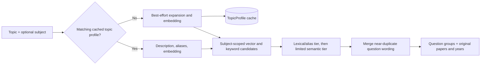

A lexical/alias hit is ranked in the trusted tier. Semantic-only candidates require the configured similarity threshold (default 0.5) and are limited to three by default. Duplicate grouping preserves appearances so a repeated question still links to each source paper.

Topic profiles are standalone cached records keyed by normalized topic and subject context, with the model identifier stored alongside the vector. A search loads the complete selection with one query. Exact phrases rank ahead of other lexical matches; partial multi-word matches need at least 60% token overlap to qualify as trusted lexical evidence. Numerical and programming-language differences prevent inappropriate duplicate merging. A profile does not guarantee a question is relevant; the original paper remains the evidence.

Embedding requests share a bounded cache (512 entries, 30-minute expiry) and overlapping batches reuse in-flight requests. Query/document tasks remain distinct. Topic-frequency scoring aggregates the top matching paper chunks inside PostgreSQL, twenty topics per query, instead of returning chunk text for each topic.

Generation routes retrieve course material when a subject is supplied. The agent can invoke retrieval and study tools on behalf of the authenticated user. Quizzes and flashcards reject unusable generated content and return 503 if generation cannot produce valid material.

### Sessions and refresh rotation

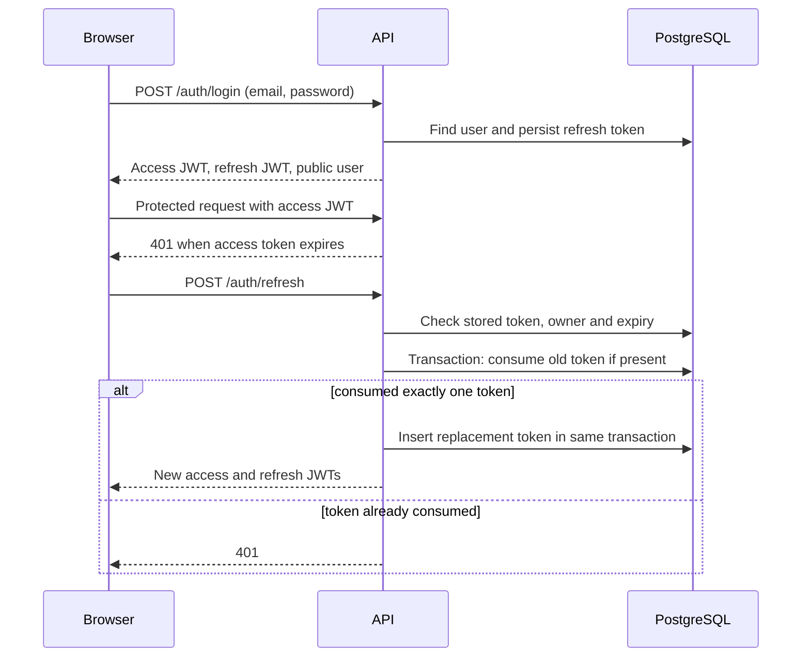

The client shares one in-flight refresh request among concurrent requests. A late refresh response cannot restore a session after logout or replace a newer login. The backend validates JWT claim shapes and restricts accepted signatures to HS256. Refresh token storage remains plaintext in the database; protecting that database and backups is essential.

### Data model

This diagram shows relationships, not every column. Exact constraints and nullable fields are defined in `backend/prisma/schema.prisma`.

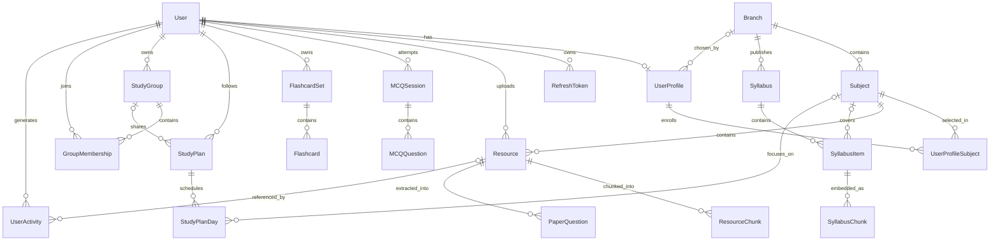

`TopicProfile` has no foreign-key relationships. It is a cache, not another course catalogue.

### Planning and active recall

The planner is deterministic code in `planBuilder.ts`, rather than an LLM-authored schedule. It matches timetable entries to enrolled subjects, prioritizes topics using past-paper evidence, and distributes learning and revision into daily time budgets. Calendar calculations use **Asia/Kolkata (UTC+05:30)** consistently. Partial timetable matches schedule matched subjects; zero matches in a supplied non-empty timetable produce an actionable validation error.

Each plan day stores structured sessions alongside its legacy topic list. Catch-up retains completed work and regenerates remaining days from the saved plan configuration. Group plans create a separate personal copy for each member.

Quiz scores and submitted choices are persisted in one transaction. Duplicate or foreign question IDs are rejected. Unattempted session responses omit the answer key; submission returns the result and explanations.

Flashcard reviews use SM-2 scheduling, adjusting ease, interval and next-review date from the student's quality rating.

### UI structure

`__root.tsx` owns document metadata, toast notifications and error boundaries. `_layout.tsx` supplies shared navigation for feature pages. The paper library also uses the shared Header; the animated landing page has its own navigation. File-based route types are generated; do not hand-edit `routeTree.gen.ts`.

The original visual design is retained. The header has primary learning links, secondary workspace links for signed-in users and a collapsible mobile menu. The paper library filters subjects through its search field. The sign-in overlay is implemented in `components/campus/LoginModal.tsx`; reusable Radix primitives are available under `components/ui/`.

## Deployment and operations guide

### Configuration and deployment

1. Provision PostgreSQL with pgvector and create separate application and migration connections where your host supports them.
2. Set the required environment variables from `backend/.env.example`. Keep secrets out of source control and frontend `VITE_*` variables.
3. Install locked dependencies, generate Prisma and build both packages.
4. Back up the database and apply committed migrations with `npm run db:migrate:deploy` in `backend/`.
5. Start the API and deploy the frontend using its configured Nitro/Vercel output.
6. Set `FRONTEND_URL` to the exact frontend origin. Add each trusted preview origin explicitly to `CORS_ORIGINS`.
7. Confirm health, public catalogue reads, sign-in and a protected request.

The API assumes one trusted reverse proxy in production. Review `trust proxy` for your actual network topology before deployment. CORS is a browser boundary, not authentication: direct HTTP clients still need route-level authorization.

The Docker Compose file runs only the API, with an external database. It does not run migrations or the frontend. Both Docker stages use Node 22. The build context excludes environment files and local dependencies.

### Local development

Use two terminals:

```sh
# Terminal 1
cd backend
npm run dev
```

```sh
# Terminal 2
cd frontend
npm run dev -- --port 3000
```

If using port 3010, for example, set `CORS_ORIGINS=http://localhost:3010,http://127.0.0.1:3010` in the API environment and restart it. These are different origins. `VITE_API_URL` is embedded in the frontend build; a production change requires a rebuild.

### Seeding

Local demo accounts are intentionally simple for development. In production the seed requires `SEED_ADMIN_PASSWORD` and `SEED_TEACHER_PASSWORD`, each at least 12 characters. The seed upserts existing accounts without changing their passwords. Re-running it does **not** rotate credentials for an existing user.

Subjects come from the optional root OUTPUT directory. The seed creates branch records even when that directory is missing. Manage subjects through the admin catalogue if no paper collection is available.

### Indexing and model changes

Inspect the script's flags and configuration before running it against a deployment:

- `scripts/backfill.ts`: resource chunks; supports branch and missing-only filtering.
- `scripts/backfillQuestions.ts`: individual questions.
- `scripts/buildTopicProfiles.ts`: cached topic descriptions, aliases and query vectors.
- `scripts/bulkUpload.ts`: collection import; can write many resources and consume provider quotas.

When changing embedding providers, do not mix old and new vectors even if dimensions match:

1. Pause retrieval traffic or use a maintenance window.
2. Back up the database.
3. Set the new provider keys consistently for the API and maintenance scripts.
4. Re-index resource chunks, individual questions and syllabus chunks; verify the scripts' coverage for your data.
5. Rebuild stale topic profiles and restart API processes to clear in-memory caches.
6. Verify known queries against known papers before restoring traffic.

The current scripts are maintenance tools, not a versioned index migration system. For a larger deployment, build a new index alongside the old one and switch after validation.

### Troubleshooting

| Symptom                                   | Check                                                                                                                        |
| ----------------------------------------- | ---------------------------------------------------------------------------------------------------------------------------- |
| Empty course list                         | Was the optional OUTPUT collection available at seed time? Add subjects in the admin catalogue.                              |
| Browser CORS error                        | Exact scheme, hostname and port in FRONTEND_URL/CORS_ORIGINS; restart the API.                                               |
| Quizzes or flashcards return 503          | Provider credentials, quota, configured model availability and generation logs. No placeholder material is saved.            |
| Uploaded paper cannot be found by topic   | Background ingestion may still be running or may have failed; inspect logs and backfill.                                     |
| Search changed after a key update         | Verify the embedding provider/model and re-index incompatible vectors.                                                       |
| Prisma asks to reset an existing database | Stop and inspect migration history/drift. Use migrate deploy for committed migrations; do not approve a data reset casually. |
| Prisma client file is locked on Windows   | Stop running API/watch processes before generating the client.                                                               |
| Health is green but data requests fail    | Health checks process liveness only; verify the database and external services separately.                                   |

### Recovery and scale

SIGINT/SIGTERM stop new HTTP connections and drain active requests before Prisma disconnects. A ten-second deadline bounds shutdown; a long agent stream or indexing task can be interrupted. Background indexing should move to a durable queue before reliable multi-instance operation.

Global limits are in-memory (200 requests/minute per client IP, auth 20/15 minutes). Some expensive routes have additional limits. Review user-based quotas, shared rate-limit storage, durable ingestion jobs and centralized monitoring before increasing traffic.

Maintain database backups, monitor failed ingestion and orphaned-file cleanup logs, and verify recovery against a non-production environment. Automated tests mock database methods and do not replace PostgreSQL transaction or live-provider integration tests.

## Contributing

Install dependencies with `npm ci` separately in frontend and backend. Use Node 22.12+ and keep lockfiles committed with dependency changes. Never commit .env files, credentials, original student data or generated build output.

### Before opening a change

Run backend typecheck, lint, tests and build; run frontend typecheck, lint and build. CI repeats these checks. The backend regression suite uses a temporary HTTP server, fake credentials and database stubs. No live services are required.

For UI changes, inspect a narrow mobile viewport and a desktop viewport. Test keyboard navigation, focus return after dialogs, empty/error/loading states and signed-out behavior. Match existing semantic color tokens and reusable components. Prefer plain, actionable labels.

### Structure

- HTTP routes validate requests, enforce authorization and shape responses.
- Keep scheduling and ranking logic in pure helpers with behavioral tests.
- Keep account-owned queries scoped to the authenticated user.
- Treat AI/provider responses as untrusted input and validate them before persistence.
- Change the Prisma schema through a new migration; never rewrite already-applied migrations.
- TanStack uses file-based routing. Do not edit generated routeTree.gen.ts manually.
- Update the relevant README sections when behavior or deployment steps change.

Use `npm run format` in frontend for Prettier. Avoid unrelated dependency upgrades. Explain the problem, resulting behavior, verification and remaining limitations in a pull request.

Keep project analysis, diagrams, setup and operational instructions together in this README.

## Frontend routing conventions

TanStack Start uses **file-based routing**. Every route `.tsx` file under `frontend/src/routes/`
defines a route. Do **not** create `src/pages/`, `src/routes/_app/index.tsx`, or
`app/layout.tsx` — those are Next.js / Remix conventions. The root layout is `frontend/src/routes/__root.tsx`.

### Conventions

| File                     | URL                                                     |
| ------------------------ | ------------------------------------------------------- |
| `index.tsx`              | `/`                                                     |
| `about.tsx`              | `/about`                                                |
| `users/index.tsx`        | `/users`                                                |
| `users/$id.tsx`          | `/users/:id` (dynamic — bare `$`, no curly braces)      |
| `posts/{-$category}.tsx` | `/posts/:category?` (optional segment)                  |
| `files/$.tsx`            | `/files/*` (splat — read via `_splat` param, never `*`) |
| `_layout.tsx`            | layout route (renders children via `<Outlet />`)        |
| `__root.tsx`             | app shell — wraps every page; preserve `<Outlet />`     |

`routeTree.gen.ts` is auto-generated. Don't edit it by hand.

## Feature review and efficiency changes

This pass preserves the existing UI design. The Streamlit paper-chat integration has been restored alongside the built-in AI Coach. Improvements target behavior, database work, provider calls and recovery from errors.

### Review coverage

| Feature                       | Changes or review outcome                                                                                                                                                                                                                                                                                                                                                                                                                                                                            | Verification                                                                                           |
| ----------------------------- | ---------------------------------------------------------------------------------------------------------------------------------------------------------------------------------------------------------------------------------------------------------------------------------------------------------------------------------------------------------------------------------------------------------------------------------------------------------------------------------------------------- | ------------------------------------------------------------------------------------------------------ |
| Authentication and sessions   | Concurrent reads share work per access token. A late 401 reuses a newer access token before rotating again. Feature pages remount on account changes so local state cannot carry into another account. Earlier atomic refresh rotation remains in place.                                                                                                                                                                                                                                             | Token/refresh route tests, request-pool tests, type checks                                             |
| Paper library                 | Subject search is debounced and obsolete requests are cancelled. The existing header search opens the paper library with a query on Enter from other pages. Course filters are preserved.                                                                                                                                                                                                                                                                                                            | Type checks and production build                                                                       |
| Uploads                       | Browser file checks match the API's PDF/PNG/JPEG/WebP and 25 MB limits, reject empty files, and avoid uploading known-invalid content. Subject choices load for the selected course. The file input resets after success.                                                                                                                                                                                                                                                                            | Type/size tests, upload route tests                                                                    |
| PDF ingestion                 | Per-page text from pdf-parse v2 is retained for source-page links. Non-Latin text is recognized. Document downloads enforce the 25 MB bound on actual streamed bytes, including responses without a size header.                                                                                                                                                                                                                                                                                     | Real two-page PDF parser test, Unicode and streamed-size tests                                         |
| Admin catalogue               | Branch/subject deletes lock their parent row before checking children, preventing a concurrent new record from being cascade-deleted. Filter requests cancel safely and created/moved subjects respect active filters. Branch filters can use IDs directly.                                                                                                                                                                                                                                          | Guarded-delete route test, type checks                                                                 |
| Profile and enrolment         | Reading an existing profile no longer performs an upsert. Subject requests use branch IDs, cancel when selection changes, and clear stale errors. Existing subject-add/remove authorization remains.                                                                                                                                                                                                                                                                                                 | Existing-profile route test, type checks                                                               |
| Syllabus                      | Suggestions fetch only the chosen subject's units. Parsed units are validated and saved atomically. Manual and parsed units reject subjects outside the syllabus's branch and semester.                                                                                                                                                                                                                                                                                                              | Subject-scope/filter route tests, generation validation, type checks                                   |
| RAG / PYQ Finder              | One profile lookup for the full topic selection; normalized/de-duplicated topics; exact phrases rank first; a lone shared word no longer qualifies as trusted multi-word evidence. Word-based candidates remain available without embeddings. Distinct numerical/C++/C# questions are preserved, and repeated candidate rows cannot inflate appearances. Invalid subject IDs fail before AI work. Generic aliases such as "equation" or "functions" are discarded, including in existing cache rows. | Ranking/grouping tests, bound-query tests, cache/profile tests                                         |
| Embeddings and topic profiles | Shared, bounded 512-entry cache with 30-minute expiry; overlapping batches reuse in-flight work. Invalid, zero or non-finite vectors are rejected. Identical concurrent profile expansions share calls, missing Gemini configuration skips expansion immediately, and aliases are matched by topic rather than array position. Query requests have shorter retry/timeout budgets than ingestion.                                                                                                     | Overlap/eviction/failure/vector tests and mocked provider tests                                        |
| Topic-frequency scoring       | Twenty topics are scored per database round trip, returning totals instead of full chunk text. Original scoring semantics are preserved.                                                                                                                                                                                                                                                                                                                                                             | Read-only check against configured PostgreSQL/pgvector, compared with the reference query              |
| Quizzes                       | Answers are grouped by selected option, reducing up to 30 individual choice writes to at most four. Reset, choices and score remain transactional. Shared generation validation rejects invalid answer indexes and repeated/blank options rather than guessing an answer.                                                                                                                                                                                                                            | Atomic submission and shared-generation tests                                                          |
| Flashcards                    | Reviews lock the current card schedule. Repeated UI taps are blocked during saving, failed saves retain the current card, and empty libraries skip the due-count query. Generated prompts are validated and de-duplicated.                                                                                                                                                                                                                                                                           | Review ordering, empty-library and generation tests                                                    |
| Study plans and catch-up      | Changes to an owned plan take a plan lock before updating session JSON or regenerating days, avoiding lost edits and inconsistent completion checks. Scheduling still uses deterministic IST date calculations.                                                                                                                                                                                                                                                                                      | Planner/date tests, type checks; concurrent PostgreSQL scheduling remains a staging check              |
| Study groups                  | Joining, leaving, ownership transfer and member removal synchronize on the group row. Capacity checks occur under that lock. Ownership is checked again at mutations. Shared-plan creation rechecks ownership, active plans and current members before writing.                                                                                                                                                                                                                                      | Full/existing-member/owner-leave tests; true parallel transaction behavior remains a staging check     |
| Personal dashboard            | Readiness counts each subject in a multi-subject day, credits completed sessions for that subject, handles legacy plans, and excludes exam-only sessions.                                                                                                                                                                                                                                                                                                                                            | Multi-subject and legacy progress tests                                                                |
| AI Coach                      | Client disconnection aborts the agent stream. Agent chat supports Gemini-only configuration; generated quizzes/flashcards still require Groq or OpenAI. Agent-generated quizzes and flashcards use the same validators as the standalone routes.                                                                                                                                                                                                                                                     | Stream/parser and shared-generation tests, type checks; live model behavior remains provider-dependent |
| Mock papers and export        | Topic analysis now supplies subject context to retrieval. The existing PDF writer, source labels and download lifecycle are retained.                                                                                                                                                                                                                                                                                                                                                                | Type checks and build; the PDF writer's standard-font/Latin-1 limitation remains                       |

### Efficiency claims and limits

These are reductions in requests and query counts established by code and tests, not measured throughput or latency claims:

- Up to ten topic-profile reads become one lookup per finder search.
- Topic-frequency searches use one database query per twenty topics.
- Quiz choice writes are bounded by four options, rather than the number of questions.
- Identical concurrent GETs share a request only while in flight; settled data is not cached, and writes advance the request generation.
- Embedding batches share duplicate input work, but query/document tasks and embedding providers stay separate.

The automated suite contains **63 passing checks**. HTTP tests use fake credentials and database stubs; provider tests replace network calls with deterministic responses. One opt-in read-only check also verifies real pgvector scoring SQL against the configured database:

```sh
cd backend
npm run test:retrieval:live
```

It makes no AI calls, writes or migrations. No production records were created to verify destructive or concurrent flows. Run multi-client PostgreSQL concurrency tests and live model generation in staging before claiming those paths are fully end-to-end verified.

Existing operational limits remain: ingestion is not a durable queue, caches/rate limits are per process, vector-model changes require re-indexing, and AI output requires review against original sources. No schema migration is required for this pass.

## Project analysis and design report

The original academic analysis, module descriptions and diagrams are retained here. These diagrams describe conceptual flows and selected fields; current source and the maintained architecture, setup, permissions and operations sections above define implementation details. Historical feasibility goals are design considerations, not measured capacity or provider guarantees.

### Chapter 2: Problem Statement

#### 2.1 Problem Definition

Students preparing for university exams face four problems:

1. **Scattered resources.** Past papers, syllabi and notes are spread across WhatsApp groups, drives and photos. There is no single searchable source organised by branch, semester and subject.
2. **Hard to find what matters.** Papers are mostly PDFs, many of them scans. Students can't easily answer "which topics are asked most often?" or "show me every past question on binary trees."
3. **Passive revision.** Reading old papers doesn't test recall. Students have no easy way to turn that content into quizzes, flashcards or a realistic mock paper.
4. **No structured planning or tracking.** Students rarely have an exam-date-driven plan, a view of their weak areas, or a way to study together with peers.

Teachers and admins also need a simple way to upload papers and maintain the syllabus, so that the content stays organised and searchable.

#### 2.2 Objectives

- Provide a **central repository** of PYQ papers organised as Branch → Semester → Subject → Resource.
- **Digitise and index** uploaded PDFs, including scanned ones via vision extraction. Papers are split into chunks and individual questions, then embedded for semantic search.
- Enable **topic-wise PYQ search** that returns de-duplicated real questions along with the papers and years they appeared in.
- Improve **topic search accuracy** by expanding each syllabus topic into a description and a list of aliases, caching that profile, and ranking keyword and alias matches above purely semantic matches.
- Provide an **AI study coach** (a tool-using agent) that can search papers, rank commonly asked topics, read the syllabus, review quiz history, and generate quizzes, flashcards and mock papers.
- Support **active learning** through MCQ practice sessions with scoring and history, and flashcards scheduled with the SM-2 spaced-repetition algorithm.
- Offer **study plans** and **study groups** (invite-code based) for planning and collaboration.
- Show a **personalised dashboard** based on the student's profile and activity.
- Provide **role-based access** (Student, Teacher, Admin) with secure authentication.
- Stay usable on **free-tier AI quotas** by chaining several models, falling back automatically, and caching anything that would otherwise cost an API call on every click.

---

### Chapter 3: Analysis

#### 3.1 Software Requirement Specifications

##### 3.1.1 Functional Requirements of the Project

| ID    | Module              | Requirement                                                                                                                                                                                                                                                                                       |
| ----- | ------------------- | ------------------------------------------------------------------------------------------------------------------------------------------------------------------------------------------------------------------------------------------------------------------------------------------------- |
| FR-1  | Authentication      | Users can register (students via a public endpoint, other roles via a protected one), log in, refresh tokens and log out.                                                                                                                                                                         |
| FR-2  | Authorization       | Three roles exist: `STUDENT`, `TEACHER`, `ADMIN`. Uploading and deleting papers is restricted to Teachers and Admins.                                                                                                                                                                             |
| FR-3  | Academic catalogue  | Users can browse branches and subjects, filtered by semester. Admin actions can create and delete branches.                                                                                                                                                                                       |
| FR-4  | Resources (PYQs)    | Teachers or admins upload a PDF with subject, year and exam type (Mid-Sem or End-Sem). Users can list, filter and view papers.                                                                                                                                                                    |
| FR-5  | Ingestion pipeline  | After upload the system extracts text (or uses vision for scans), chunks it, segments individual questions and stores embeddings.                                                                                                                                                                 |
| FR-6  | PYQ question search | Students search past questions by topic, using semantic and keyword matching, with de-duplication and the years each appeared.                                                                                                                                                                    |
| FR-6a | Topic profiles      | Each topic is expanded once into a description and aliases (optionally scoped by subject name), stored in the database and reused for embedding, keyword matching and ranking.                                                                                                                    |
| FR-7  | Syllabus            | Syllabus is stored per branch, semester and scheme as units, topics and hours. Its text is embedded for retrieval.                                                                                                                                                                                |
| FR-8  | MCQ practice        | Generate an MCQ quiz on a topic, answer questions, get a score, and view or delete past sessions.                                                                                                                                                                                                 |
| FR-9  | Flashcards          | Create or AI-generate flashcard sets, add cards, and review cards with SM-2 scheduling (ease factor, interval, next review).                                                                                                                                                                      |
| FR-10 | Study plans         | Create day-by-day plans with subjects and topics, optionally tied to an exam date or a group, and mark days complete.                                                                                                                                                                             |
| FR-11 | Study groups        | Create a group with an invite code, join with a code, and share plans among members.                                                                                                                                                                                                              |
| FR-12 | Profile             | Students set year, branch and semester, and enrol in subjects, which personalises the rest of the app.                                                                                                                                                                                            |
| FR-13 | Dashboard           | A personalised dashboard shows activity (views, downloads, quiz attempts, plan-day completions) and progress.                                                                                                                                                                                     |
| FR-14 | AI agent            | A chat agent streams its tool calls, tool results and answer tokens. It can search papers, find common topics, generate quizzes, flashcards and a downloadable mock paper, list available papers, fetch all questions from a specific paper, and generate model answers for individual questions. |
| FR-15 | Bot handoff         | The backend returns the URL of an external AI bot service for chatting with a paper.                                                                                                                                                                                                              |
| FR-16 | Health check        | `GET /api/health` reports service status for Docker and load balancers.                                                                                                                                                                                                                           |

##### 3.1.2 Non-functional Requirements of the Project

| Category         | Requirement                                                                                                                                                                                                                                                                                                   |
| ---------------- | ------------------------------------------------------------------------------------------------------------------------------------------------------------------------------------------------------------------------------------------------------------------------------------------------------------- |
| Security         | Passwords hashed with bcrypt. Short-lived JWT access tokens (default 15 min) and refresh tokens (default 7 days) stored in the database. `helmet` headers. Strict CORS allow-list.                                                                                                                            |
| Input validation | Environment variables are validated at startup with Zod, and the process exits if they are invalid. Request payloads are validated with Zod and `express-validator`.                                                                                                                                          |
| Rate limiting    | 200 requests per minute globally. 20 requests per 15 minutes on auth endpoints. Extra limiters on question search and group joining.                                                                                                                                                                          |
| Reliability      | Embeddings are computed before old data is deleted, and delete plus insert run in one transaction. The AI layer falls through a chain of models on rate limits. If a topic profile cannot be built, search falls back to the bare topic instead of failing.                                                   |
| Performance      | Vector search uses pgvector. Subject IDs are denormalised onto chunk tables, and DB indexes cover common filters. Agent tool outputs are kept small to save tokens. Valid cached topic profiles avoid repeated expansion and embedding calls.                                                                                 |
| Scalability      | Stateless API behind a reverse proxy (`trust proxy` enabled in production). Dockerised backend with a healthcheck. External hosted Postgres and Cloudinary.                                                                                                                                                   |
| Usability        | Responsive React UI with a component library, toast feedback, and deep links (e.g. `/pyq?subjectId=…&topics=…`, `/groups?join=CODE`).                                                                                                                                                                         |
| Maintainability  | TypeScript on both frontend and backend. Prisma migrations. ESLint and Prettier. Modular route and lib structure. Topic aliases are plain data and can be edited without a deploy.                                                                                                                            |
| Cost             | Designed to run on free tiers (Groq, Gemini or Hugging Face embeddings, Cloudinary free plan, hosted Postgres free plan). A topic costs at most one LLM call and one embedding call, once; all uncached topics in a search are built together in a single pair of calls, and cached topics cost no API calls. |
| Portability      | One embedding provider per deployment (768-dim vectors) to avoid mixing incompatible vector spaces. Topic profiles record the embedding model and are rebuilt automatically if it changes.                                                                                                                    |

#### 3.2 Feasibility Study of the Project

**Technical feasibility.** The project uses mature, well-documented technologies: React and TanStack Start for the UI, Express and Prisma for the API, PostgreSQL with pgvector for relational and vector data, and LangChain/LangGraph for the agent. Hosted services handle file storage (Cloudinary), embeddings (Gemini or Hugging Face) and LLM inference (Groq, Gemini). The team needs no specialised hardware.

**Economic feasibility.** External-service quotas, pricing and available models depend on the provider; verify capacity for the intended deployment. Free-tier LLM limits are the main constraint. The design addresses them with a model fallback chain, short prompts, clamped tool outputs, and a persistent cache of topic profiles so that repeat searches make no API calls. Costs depend on provider plans and usage; optional OpenAI configuration can provide a generation fallback.

**Operational feasibility.** The workflow matches how students and teachers already work: upload a PDF, find a paper, practise. Teachers only upload papers and syllabus. Ingestion runs automatically and backfill scripts are provided for existing data. An optional script precomputes topic profiles for the whole syllabus. The backend runs in Docker with a health endpoint.

**Schedule feasibility.** The system splits into independent modules (auth, catalogue, ingestion, study tools, agent) that can be built and tested separately.

**Legal and ethical considerations.** Uploaded papers should be used under the university's policy. Student data is limited to email, name, role and study activity. Passwords are never stored in plain text.

**Risks and mitigations**

| Risk                                             | Mitigation                                                                                                                            |
| ------------------------------------------------ | ------------------------------------------------------------------------------------------------------------------------------------- |
| LLM rate limits or model retirements             | Model chain configurable via `GROQ_MODELS`, optional Gemini fallback, retries                                                         |
| Scanned PDFs with no text layer                  | Vision-based extraction through `pdfVision` and `visionExtract`                                                                       |
| Mixed embedding models corrupt search            | Single provider per deployment, with a documented re-embed requirement                                                                |
| Inaccurate AI output                             | Quiz and flashcard generation is grounded in retrieved paper and syllabus content                                                     |
| Irrelevant questions from loose semantic matches | Two-tier ranking: keyword or alias hits are trusted; semantic-only hits need similarity of at least 0.5 and are capped at 3 per topic |
| Bad aliases for a topic                          | Aliases are stored in the `TopicProfile` table and can be edited or deleted (the row rebuilds on next use)                            |
| Free-tier quota exhausted by topic expansion     | Profiles are cached persistently; uncached topics are built in one batched call; searches without a subject skip expansion             |

#### 3.3 Tools / Technologies / Platform used

| Layer          | Technology                                                                                                                                                  |
| -------------- | ----------------------------------------------------------------------------------------------------------------------------------------------------------- |
| Frontend       | React 19, TypeScript, TanStack Start, TanStack Router, TanStack Query, Vite                                                                                 |
| UI             | Tailwind CSS 4, Radix UI primitives, shadcn-style components, lucide-react, Recharts, Motion, Sonner                                                        |
| Forms          | React Hook Form with Zod resolvers                                                                                                                          |
| Backend        | Node.js, Express 4, TypeScript, `tsx`                                                                                                                       |
| Database       | PostgreSQL with the pgvector extension, accessed through Prisma 6                                                                                           |
| Auth           | JWT (`jsonwebtoken`), `bcryptjs`                                                                                                                            |
| Security       | `helmet`, `cors`, `express-rate-limit`, `express-validator`, Zod                                                                                            |
| File storage   | Cloudinary (PDF hosting), `multer` for uploads                                                                                                              |
| PDF processing | `pdf-parse`, `@napi-rs/canvas` (render pages for vision OCR)                                                                                                |
| AI / LLM       | LangChain, LangGraph (ReAct agent), Groq (`@langchain/groq`, `groq-sdk`), Google Gemini (also used, in JSON mode, to build topic profiles), optional OpenAI |
| Embeddings     | Gemini `gemini-embedding-001` (768 dims) or Hugging Face `BAAI/bge-base-en-v1.5`                                                                            |
| DevOps         | Docker and Docker Compose, Nitro server build                                                                                                               |
| Code quality   | ESLint, Prettier, TypeScript                                                                                                                                |

#### 3.4 Use Case Diagrams / Data Flow Diagrams

##### Use Case Diagram


##### Data Flow Diagram: Level 0 (Context)

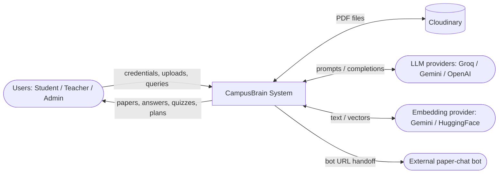

##### Data Flow Diagram: Level 1

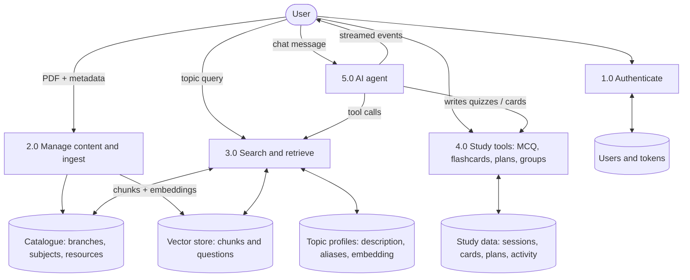

---

### Chapter 4: Design and Architecture

#### 4.1 Structure Chart / Work Breakdown Structure

##### System Structure

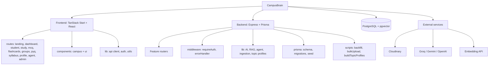

##### Work Breakdown Structure

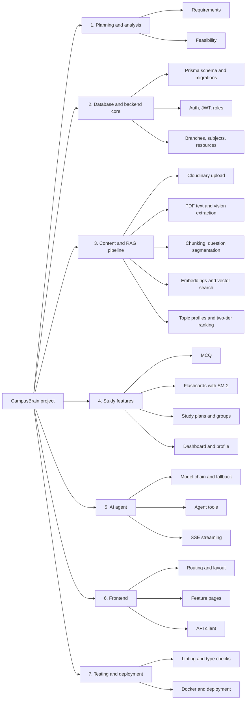

#### 4.2 Explanation of Modules

##### Backend (`backend/src`)

| Module         | Files                                                                                                                | Responsibility                                                                                                                                                                                                                                                                                        |
| -------------- | -------------------------------------------------------------------------------------------------------------------- | ----------------------------------------------------------------------------------------------------------------------------------------------------------------------------------------------------------------------------------------------------------------------------------------------------- |
| Bootstrap      | `index.ts`, `lib/env.ts`                                                                                             | Validates env vars, applies helmet, CORS, logging and rate limits, mounts routers, handles 404s and errors.                                                                                                                                                                                           |
| Auth           | `routes/auth.ts`, `lib/jwt.ts`, `middleware/requireAuth.ts`                                                          | Register, login, refresh and logout. `requireAuth([roles])` guards routes and checks roles.                                                                                                                                                                                                           |
| Catalogue      | `routes/branches.ts`, `routes/subjects.ts`                                                                           | Branch and subject listing and management.                                                                                                                                                                                                                                                            |
| Resources      | `routes/resources.ts`, `lib/cloudinary.ts`                                                                           | Upload, list, filter (including by topic) and delete PYQ papers. Teacher or Admin only for writes.                                                                                                                                                                                                    |
| Ingestion      | `lib/ingestion.ts`, `pdfText.ts`, `pdfVision.ts`, `visionExtract.ts`, `questionSegmenter.ts`, `questionIngestion.ts` | Turns a PDF into text chunks and individual questions, embeds them, and stores them transactionally.                                                                                                                                                                                                  |
| Embeddings     | `lib/embeddings.ts`                                                                                                  | Gemini or Hugging Face 768-dimension embeddings with retries.                                                                                                                                                                                                                                         |
| Topic profiles | `lib/topicProfile.ts`                                                                                                | Builds a description and aliases for topics with one batched Gemini JSON call plus one batched embedding call, stores them in `TopicProfile`, and reads them back from the database without any API call. Profiles are keyed by `subject name\|topic` and invalidated if the embedding model changes. |
| Retrieval      | `lib/retriever.ts`, `pyqSearch.ts`, `questionSearch.ts`, `topics.ts`, `routes/questions.ts`                          | Semantic and keyword search over chunks and questions. `pyqSearch.ts` resolves topics to profiles and runs the two SQL queries (pgvector nearest neighbours plus `ILIKE` on the topic and its aliases). `questionSearch.ts` ranks, tiers and de-duplicates.                                           |
| Syllabus       | `routes/syllabus.ts`                                                                                                 | Units, topics and hours per branch, semester and scheme. Items are embedded as `SyllabusChunk`.                                                                                                                                                                                                       |
| MCQ            | `routes/mcq.ts`                                                                                                      | Generates quizzes, records answers, scores sessions and returns history.                                                                                                                                                                                                                              |
| Flashcards     | `routes/flashcards.ts`                                                                                               | Sets and cards, AI generation, and SM-2 review scheduling.                                                                                                                                                                                                                                            |
| Study plans    | `routes/studyPlans.ts`, `lib/planBuilder.ts`                                                                         | Builds and tracks day-wise plans.                                                                                                                                                                                                                                                                     |
| Study groups   | `routes/studyGroups.ts`                                                                                              | Create or join groups through invite codes. Membership and ownership.                                                                                                                                                                                                                                 |
| Profile        | `routes/profile.ts`                                                                                                  | Year, branch, semester and enrolled subjects.                                                                                                                                                                                                                                                         |
| Dashboard      | `routes/dashboard.ts`                                                                                                | Aggregates user activity and progress. Records activity events.                                                                                                                                                                                                                                       |
| AI layer       | `lib/ai.ts`                                                                                                          | Chat and vision completion with a chain of Groq models, then optional providers.                                                                                                                                                                                                                      |
| Agent          | `routes/agent.ts`, `lib/agent.ts`, `lib/agentTools.ts`, `lib/mockPaper.ts`                                           | LangGraph ReAct agent streamed over SSE, with tools listed below.                                                                                                                                                                                                                                     |
| Bot handoff    | `routes/bot.ts`                                                                                                      | Returns the external bot URL.                                                                                                                                                                                                                                                                         |

**Agent tools:** `search_papers`, `search_questions`, `get_common_topics`, `build_mock_paper`, `get_syllabus`, `get_mcq_history`, `generate_mcq`, `generate_flashcards`, `list_papers`, `get_paper_questions`, `answer_question`.

- `list_papers` — lists available past exam papers for a subject (ID, year, exam type, extracted question count). Used to navigate to a specific paper before fetching its questions.
- `get_paper_questions` — fetches all extracted questions from a specific paper by ID. Returns question label, marks, and full text in order.
- `answer_question` — generates a marks-aware model answer for any question. Pulls 6 RAG chunks (papers + syllabus) as grounding context; adapts answer depth to the marks allocated (short ≤ 2, medium ≤ 5, long 6+).

**Operational scripts (`backend/scripts`):** `backfill.ts` (re-ingest resources), `backfillQuestions.ts` (re-extract questions), `bulkUpload.ts` (batch upload papers), `buildTopicProfiles.ts` (optional: precompute topic profiles for every syllabus topic; safe to re-run, skips topics already cached).

##### PYQ topic search: how it works

1. **Resolve topics.** The topic string has any `[Unit title]` prefix removed. If the request has a subject, its name is used as context (the syllabus page sends the subject name; the PYQ Finder sends a subject id and the server looks the name up), so both pages share the same cached profile.
2. **Load or build the profile.** Cached profiles are read from `TopicProfile` with no API call. All uncached topics for the request are built together: one Gemini call returns a description and up to 6 aliases per topic, and one embedding call embeds `"topic: description"`. Results are stored. Searches with no subject skip expansion and embed the bare topic.
3. **Find candidates.** The 40 nearest questions by cosine distance, plus up to 30 questions whose text matches the topic or any alias (`ILIKE ANY`).
4. **Rank in two tiers.**
   - _Trusted_: questions containing the exact topic, a validated alias, or at least 60% of the words in a multi-word topic. Scored as `similarity + 0.15 × termMatch + 0.12 (exact phrase) + 0.08 (alias)`.
   - _Semantic-only_: questions connected only by embedding similarity. They must reach similarity 0.5, only the best cluster within 0.05 of the top semantic score is kept, and at most 3 are returned.
5. **De-duplicate and summarise.** Near-identical questions across years are merged into one entry listing every paper they appeared in.

##### Frontend (`frontend/src`)

| Module            | Location                                                                                                                                    | Responsibility                                                                                                                    |
| ----------------- | ------------------------------------------------------------------------------------------------------------------------------------------- | --------------------------------------------------------------------------------------------------------------------------------- |
| App shell         | `router.tsx`, `routes/__root.tsx`, `routes/_layout.tsx`                                                                                     | Router setup and shared layout with header.                                                                                       |
| Public pages      | `routes/index.tsx`, `routes/dashboard.tsx`                                                                                                  | Landing page and paper browser.                                                                                                   |
| Student pages     | `routes/_layout/student.tsx`, `study.tsx`, `mcq.tsx`, `flashcards.tsx`, `groups.tsx`, `pyq.tsx`, `syllabus.tsx`, `profile.tsx`, `agent.tsx` | Personal dashboard and study tools.                                                                                               |
| Admin             | `routes/_layout/admin.tsx`                                                                                                                  | Upload and content management.                                                                                                    |
| Account           | `routes/_layout/register.tsx`, `components/campus/LoginModal.tsx`                                                                           | Sign-up and sign-in.                                                                                                              |
| Campus components | `components/campus/*`                                                                                                                       | Header, upload card, PYQ results. `TopicPyqPanel` takes an optional `context` (the subject name) and passes it to the search API. |
| UI kit            | `components/ui/*`                                                                                                                           | Reusable Radix and Tailwind primitives.                                                                                           |
| Client services   | `lib/api.ts`, `lib/auth.ts`                                                                                                                 | Typed API client with Bearer token handling, plus auth state.                                                                     |

##### API overview

All routes are served under `/api`.

| Prefix                   | Purpose                                                                                                                       |
| ------------------------ | ----------------------------------------------------------------------------------------------------------------------------- |
| `/auth`                  | `register-student`, `register`, `login`, `refresh`, `logout`                                                                  |
| `/branches`, `/subjects` | Catalogue                                                                                                                     |
| `/resources`             | Papers: list, `by-topic`, upload, delete                                                                                      |
| `/questions`             | `POST /search` for PYQ question search. Body: `{ topics: string[1..10], subjectId?, context?, perTopic? (1..15, default 6) }` |
| `/syllabus`              | Syllabus                                                                                                                      |
| `/mcq`                   | `generate`, `sessions`, `sessions/:id/answer`                                                                                 |
| `/flashcards`            | Sets, cards, `generate`, `cards/:cardId/review`                                                                               |
| `/study-plans`           | Study plans                                                                                                                   |
| `/groups`                | Study groups, `join`                                                                                                          |
| `/profile`               | Profile and enrolled subjects                                                                                                 |
| `/dashboard`             | `me`, `activity`                                                                                                              |
| `/agent`                 | `POST /chat` (SSE stream)                                                                                                     |
| `/bot`                   | `GET /url`                                                                                                                    |
| `/health`                | Liveness check                                                                                                                |

##### System architecture

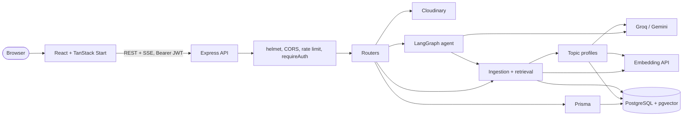

#### 4.3 Flow Chart / Activity Diagram

##### Authentication


##### Paper upload and ingestion

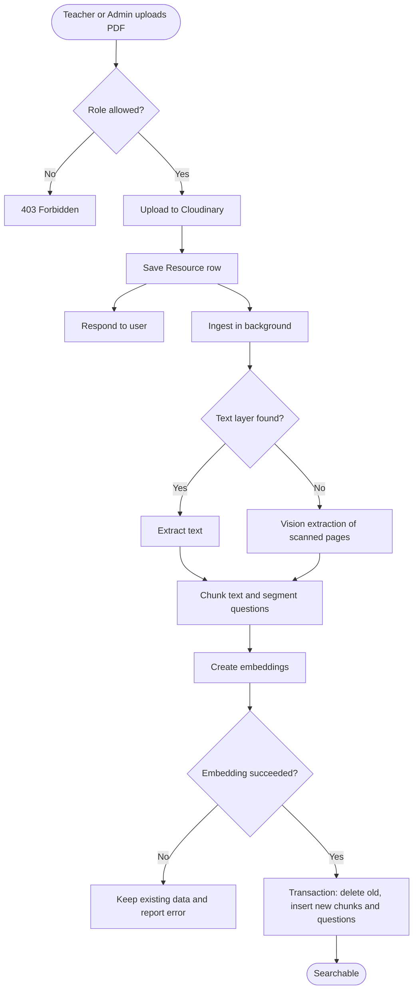

##### PYQ topic search


##### AI agent request

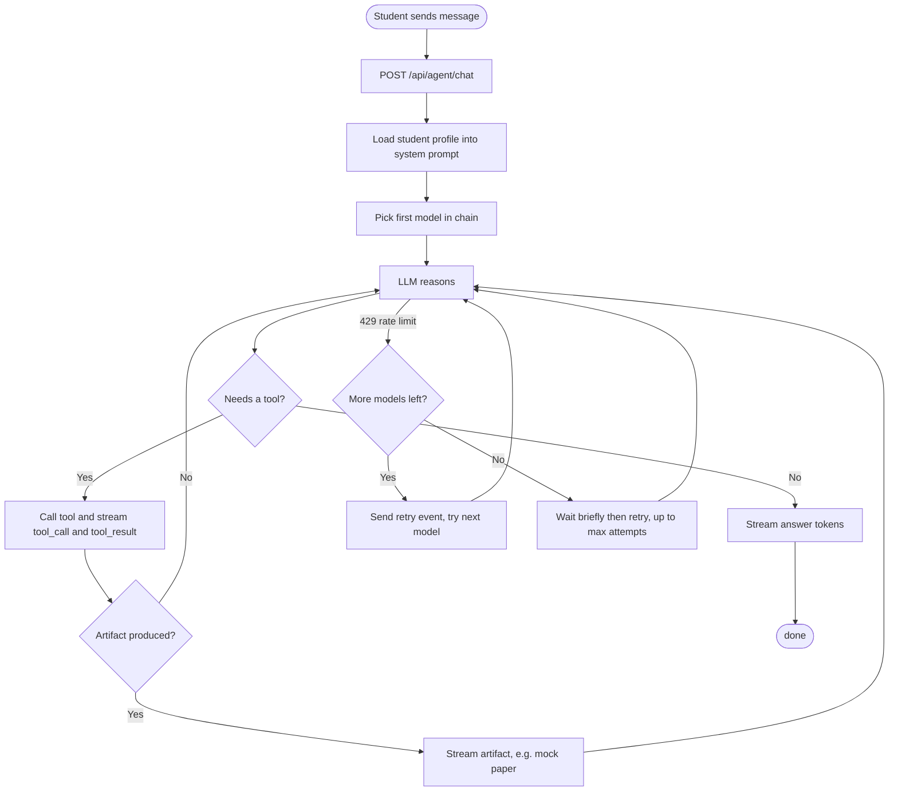

##### Flashcard review (SM-2)


#### 4.4 ER Diagram / Class Diagram

##### ER Diagram

Derived from `backend/prisma/schema.prisma`. `TopicProfile` is a standalone cache table with no foreign keys (it is keyed by the text `subject name|topic`).

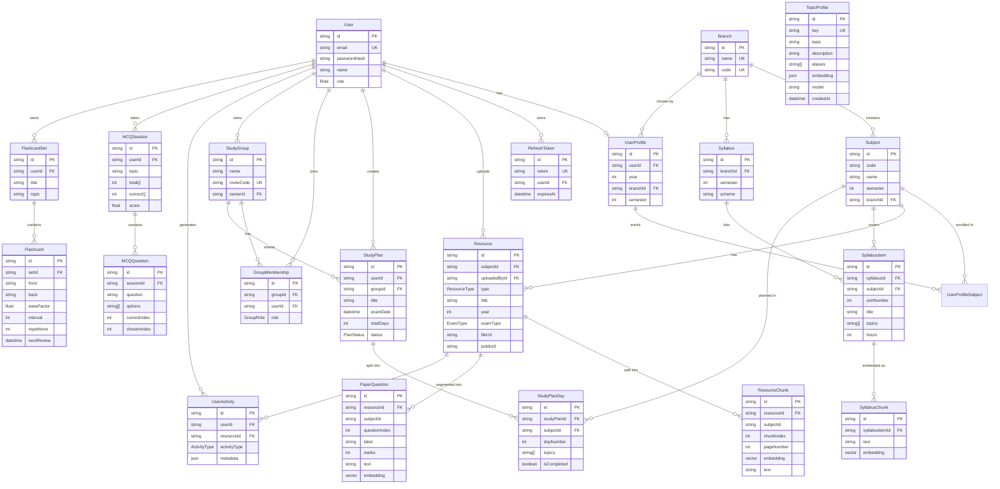

Enums: `Role` (STUDENT, TEACHER, ADMIN), `ExamType` (MID_SEM, END_SEM), `ResourceType` (PAPER, NOTES, SYLLABUS), `PlanStatus` (ACTIVE, COMPLETED, PAUSED), `GroupRole` (OWNER, MEMBER), `ActivityType` (VIEW, DOWNLOAD, QUIZ_ATTEMPT, PLAN_DAY_COMPLETE).

##### Class Diagram (backend AI and retrieval layer)


---
