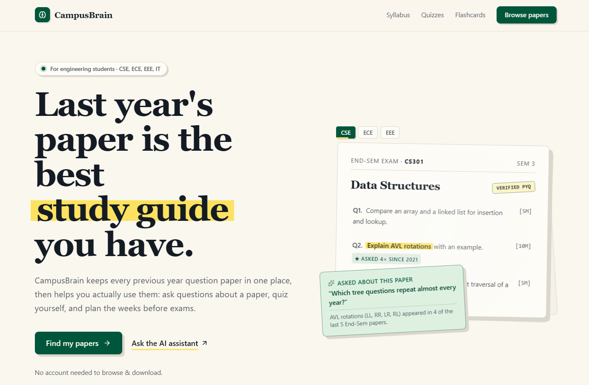
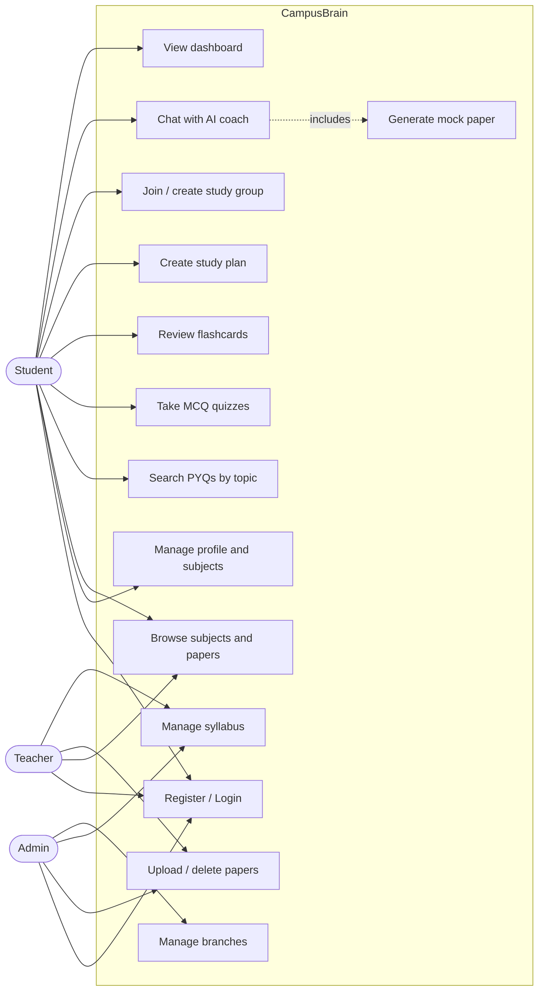
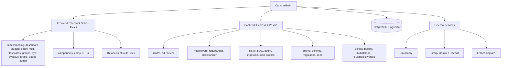
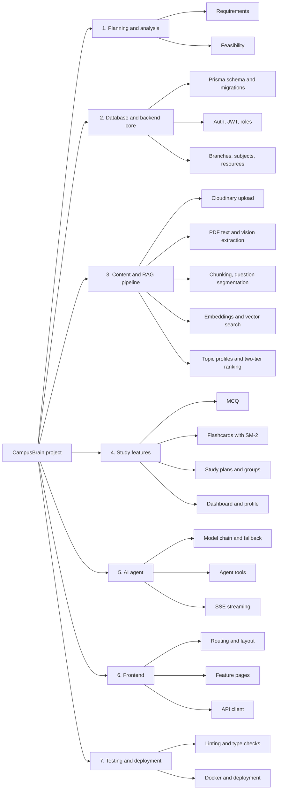
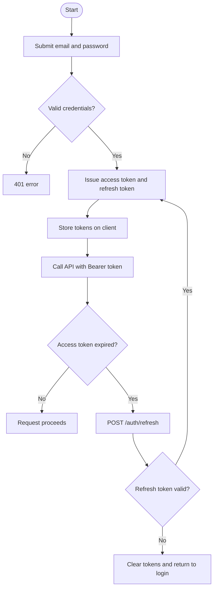
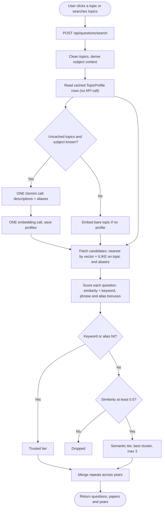
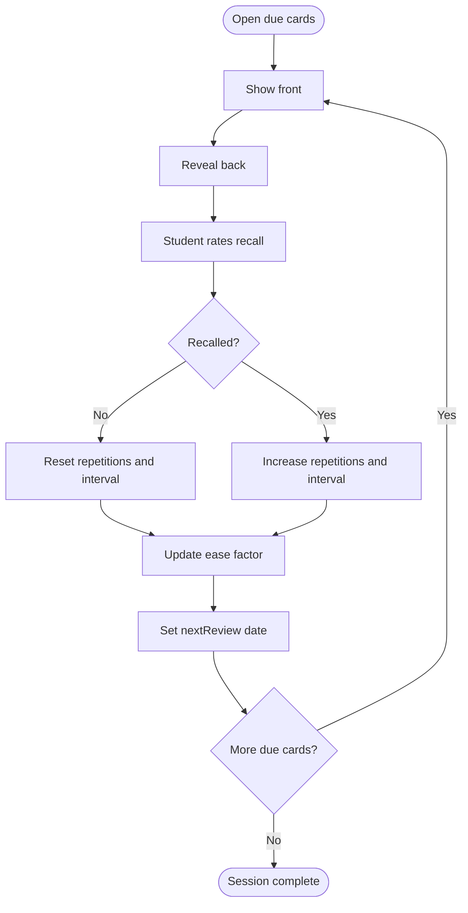
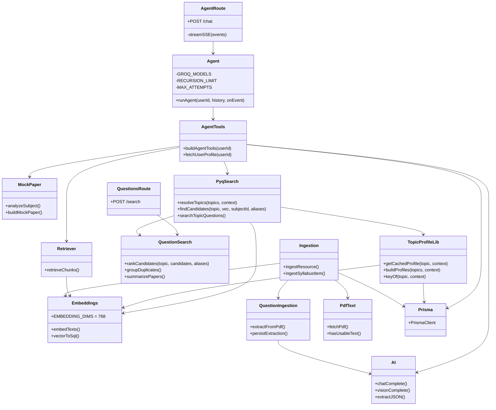

# CampusBrain




An academic portal for university students. It brings previous year question papers (PYQs), syllabus, practice tools and an AI study coach together in one place. Students browse papers by branch, semester and subject. They find real past questions by topic, practise with generated MCQs and spaced-repetition flashcards, and build day-by-day study plans. An AI agent can also build a full mock exam paper.

## Demo Accounts

| Email                     | Password     | Role    |
| ------------------------- | ------------ | ------- |
| admin@campusbrain.edu     | `admin`      | ADMIN   |
| teacher@campusbrain.edu   | `teacher123` | TEACHER |

---

## Chapter 2: Problem Statement

### 2.1 Problem Definition

Students preparing for university exams face four problems:

1. **Scattered resources.** Past papers, syllabi and notes are spread across WhatsApp groups, drives and photos. There is no single searchable source organised by branch, semester and subject.
2. **Hard to find what matters.** Papers are mostly PDFs, many of them scans. Students can't easily answer "which topics are asked most often?" or "show me every past question on binary trees."
3. **Passive revision.** Reading old papers doesn't test recall. Students have no easy way to turn that content into quizzes, flashcards or a realistic mock paper.
4. **No structured planning or tracking.** Students rarely have an exam-date-driven plan, a view of their weak areas, or a way to study together with peers.

Teachers and admins also need a simple way to upload papers and maintain the syllabus, so that the content stays organised and searchable.

### 2.2 Objectives

- Provide a **central repository** of PYQ papers organised as Branch → Semester → Subject → Resource.
- **Digitise and index** uploaded PDFs, including scanned ones via vision extraction. Papers are split into chunks and individual questions, then embedded for semantic search.
- Enable **topic-wise PYQ search** that returns de-duplicated real questions along with the papers and years they appeared in.
- Improve **topic search accuracy** by expanding each syllabus topic into a description and a list of aliases, caching that profile, and ranking keyword and alias matches above purely semantic matches.
- Provide an **AI study coach** (a tool-using agent) that can search papers, rank commonly asked topics, read the syllabus, review quiz history, and generate quizzes, flashcards and mock papers.
- Support **active learning** through MCQ practice sessions with scoring and history, and flashcards scheduled with the SM-2 spaced-repetition algorithm.
- Offer **study plans** and **study groups** (invite-code based) for planning and collaboration.
- Show a **personalised dashboard** based on the student's profile and activity.
- Provide **role-based access** (Student, Teacher, Admin) with secure authentication.
- Stay usable on **free-tier AI quotas** by chaining several models, falling back automatically, and caching anything that would otherwise cost an API call on every click.

---

## Chapter 3: Analysis

### 3.1 Software Requirement Specifications

#### 3.1.1 Functional Requirements of the Project

| ID    | Module               | Requirement                                                                                                                      |
| ----- | -------------------- | -------------------------------------------------------------------------------------------------------------------------------- |
| FR-1  | Authentication       | Users can register (students via a public endpoint, other roles via a protected one), log in, refresh tokens and log out.        |
| FR-2  | Authorization        | Three roles exist: `STUDENT`, `TEACHER`, `ADMIN`. Uploading and deleting papers is restricted to Teachers and Admins.            |
| FR-3  | Academic catalogue   | Users can browse branches and subjects, filtered by semester. Admin actions can create and delete branches.                      |
| FR-4  | Resources (PYQs)     | Teachers or admins upload a PDF with subject, year and exam type (Mid-Sem or End-Sem). Users can list, filter and view papers.   |
| FR-5  | Ingestion pipeline   | After upload the system extracts text (or uses vision for scans), chunks it, segments individual questions and stores embeddings. |
| FR-6  | PYQ question search  | Students search past questions by topic, using semantic and keyword matching, with de-duplication and the years each appeared.   |
| FR-6a | Topic profiles       | Each topic is expanded once into a description and aliases (optionally scoped by subject name), stored in the database and reused for embedding, keyword matching and ranking. |
| FR-7  | Syllabus             | Syllabus is stored per branch, semester and scheme as units, topics and hours. Its text is embedded for retrieval.               |
| FR-8  | MCQ practice         | Generate an MCQ quiz on a topic, answer questions, get a score, and view or delete past sessions.                                |
| FR-9  | Flashcards           | Create or AI-generate flashcard sets, add cards, and review cards with SM-2 scheduling (ease factor, interval, next review).     |
| FR-10 | Study plans          | Create day-by-day plans with subjects and topics, optionally tied to an exam date or a group, and mark days complete.            |
| FR-11 | Study groups         | Create a group with an invite code, join with a code, and share plans among members.                                             |
| FR-12 | Profile              | Students set year, branch and semester, and enrol in subjects, which personalises the rest of the app.                           |
| FR-13 | Dashboard            | A personalised dashboard shows activity (views, downloads, quiz attempts, plan-day completions) and progress.                    |
| FR-14 | AI agent             | A chat agent streams its tool calls, tool results and answer tokens. It can search papers, find common topics, generate quizzes, flashcards and a downloadable mock paper, list available papers, fetch all questions from a specific paper, and generate model answers for individual questions. |
| FR-15 | Bot handoff          | The backend returns the URL of an external AI bot service for chatting with a paper.                                             |
| FR-16 | Health check         | `GET /api/health` reports service status for Docker and load balancers.                                                          |

#### 3.1.2 Non-functional Requirements of the Project

| Category            | Requirement                                                                                                                                      |
| ------------------- | ------------------------------------------------------------------------------------------------------------------------------------------------ |
| Security            | Passwords hashed with bcrypt. Short-lived JWT access tokens (default 15 min) and refresh tokens (default 7 days) stored in the database. `helmet` headers. Strict CORS allow-list. |
| Input validation    | Environment variables are validated at startup with Zod, and the process exits if they are invalid. Request payloads are validated with Zod and `express-validator`. |
| Rate limiting       | 200 requests per minute globally. 20 requests per 15 minutes on auth endpoints. Extra limiters on question search and group joining.             |
| Reliability         | Embeddings are computed before old data is deleted, and delete plus insert run in one transaction. The AI layer falls through a chain of models on rate limits. If a topic profile cannot be built, search falls back to the bare topic instead of failing. |
| Performance         | Vector search uses pgvector. Subject IDs are denormalised onto chunk tables, and DB indexes cover common filters. Agent tool outputs are kept small to save tokens. Cached topic profiles make repeat searches database-only. |
| Scalability         | Stateless API behind a reverse proxy (`trust proxy` enabled in production). Dockerised backend with a healthcheck. External hosted Postgres and Cloudinary. |
| Usability           | Responsive React UI with a component library, toast feedback, and deep links (e.g. `/pyq?subjectId=…&topics=…`, `/groups?join=CODE`).            |
| Maintainability     | TypeScript on both frontend and backend. Prisma migrations. ESLint and Prettier. Modular route and lib structure. Topic aliases are plain data and can be edited without a deploy. |
| Cost                | Designed to run on free tiers (Groq, Gemini or Hugging Face embeddings, Cloudinary free plan, hosted Postgres free plan). A topic costs at most one LLM call and one embedding call, once; all uncached topics in a search are built together in a single pair of calls, and cached topics cost no API calls. |
| Portability         | One embedding provider per deployment (768-dim vectors) to avoid mixing incompatible vector spaces. Topic profiles record the embedding model and are rebuilt automatically if it changes. |

### 3.2 Feasibility Study of the Project

**Technical feasibility.** The project uses mature, well-documented technologies: React and TanStack Start for the UI, Express and Prisma for the API, PostgreSQL with pgvector for relational and vector data, and LangChain/LangGraph for the agent. Hosted services handle file storage (Cloudinary), embeddings (Gemini or Hugging Face) and LLM inference (Groq, Gemini). The team needs no specialised hardware.

**Economic feasibility.** Every external service used has a free tier that covers a campus-scale prototype. Free-tier LLM limits are the main constraint. The design addresses them with a model fallback chain, short prompts, clamped tool outputs, and a persistent cache of topic profiles so that repeat searches make no API calls. Costs would grow only with usage, and paid keys such as OpenAI can be added as a fallback.

**Operational feasibility.** The workflow matches how students and teachers already work: upload a PDF, find a paper, practise. Teachers only upload papers and syllabus. Ingestion runs automatically and backfill scripts are provided for existing data. An optional script precomputes topic profiles for the whole syllabus. The backend runs in Docker with a health endpoint.

**Schedule feasibility.** The system splits into independent modules (auth, catalogue, ingestion, study tools, agent) that can be built and tested separately.

**Legal and ethical considerations.** Uploaded papers should be used under the university's policy. Student data is limited to email, name, role and study activity. Passwords are never stored in plain text.

**Risks and mitigations**

| Risk                                    | Mitigation                                                                  |
| --------------------------------------- | --------------------------------------------------------------------------- |
| LLM rate limits or model retirements    | Model chain configurable via `GROQ_MODELS`, optional Gemini fallback, retries |
| Scanned PDFs with no text layer         | Vision-based extraction through `pdfVision` and `visionExtract`             |
| Mixed embedding models corrupt search   | Single provider per deployment, with a documented re-embed requirement      |
| Inaccurate AI output                    | Quiz and flashcard generation is grounded in retrieved paper and syllabus content |
| Irrelevant questions from loose semantic matches | Two-tier ranking: keyword or alias hits are trusted; semantic-only hits need similarity of at least 0.5 and are capped at 3 per topic |
| Bad aliases for a topic                 | Aliases are stored in the `TopicProfile` table and can be edited or deleted (the row rebuilds on next use) |
| Free-tier quota exhausted by topic expansion | Profiles are cached permanently; uncached topics are built in one batched call; searches without a subject skip expansion |

### 3.3 Tools / Technologies / Platform used

| Layer          | Technology                                                                                      |
| -------------- | ----------------------------------------------------------------------------------------------- |
| Frontend       | React 19, TypeScript, TanStack Start, TanStack Router, TanStack Query, Vite                     |
| UI             | Tailwind CSS 4, Radix UI primitives, shadcn-style components, lucide-react, Recharts, Motion, Sonner |
| Forms          | React Hook Form with Zod resolvers                                                              |
| Backend        | Node.js, Express 4, TypeScript, `tsx`                                                           |
| Database       | PostgreSQL with the pgvector extension, accessed through Prisma 6                               |
| Auth           | JWT (`jsonwebtoken`), `bcryptjs`                                                                |
| Security       | `helmet`, `cors`, `express-rate-limit`, `express-validator`, Zod                                |
| File storage   | Cloudinary (PDF hosting), `multer` for uploads                                                  |
| PDF processing | `pdf-parse`, `@napi-rs/canvas` (render pages for vision OCR)                                    |
| AI / LLM       | LangChain, LangGraph (ReAct agent), Groq (`@langchain/groq`, `groq-sdk`), Google Gemini (also used, in JSON mode, to build topic profiles), optional OpenAI |
| Embeddings     | Gemini `gemini-embedding-001` (768 dims) or Hugging Face `BAAI/bge-base-en-v1.5`                |
| DevOps         | Docker and Docker Compose, Nitro server build                                                   |
| Code quality   | ESLint, Prettier, TypeScript                                                                    |

### 3.4 Use Case Diagrams / Data Flow Diagrams

#### Use Case Diagram



#### Data Flow Diagram: Level 0 (Context)


#### Data Flow Diagram: Level 1


---

## Chapter 4: Design and Architecture

### 4.1 Structure Chart / Work Breakdown Structure

#### System Structure



#### Work Breakdown Structure



### 4.2 Explanation of Modules

#### Backend (`backend/src`)

| Module        | Files                                       | Responsibility                                                                                                      |
| ------------- | ------------------------------------------- | ------------------------------------------------------------------------------------------------------------------- |
| Bootstrap     | `index.ts`, `lib/env.ts`                    | Validates env vars, applies helmet, CORS, logging and rate limits, mounts routers, handles 404s and errors.         |
| Auth          | `routes/auth.ts`, `lib/jwt.ts`, `middleware/requireAuth.ts` | Register, login, refresh and logout. `requireAuth([roles])` guards routes and checks roles.          |
| Catalogue     | `routes/branches.ts`, `routes/subjects.ts`  | Branch and subject listing and management.                                                                          |
| Resources     | `routes/resources.ts`, `lib/cloudinary.ts`  | Upload, list, filter (including by topic) and delete PYQ papers. Teacher or Admin only for writes.                  |
| Ingestion     | `lib/ingestion.ts`, `pdfText.ts`, `pdfVision.ts`, `visionExtract.ts`, `questionSegmenter.ts`, `questionIngestion.ts` | Turns a PDF into text chunks and individual questions, embeds them, and stores them transactionally. |
| Embeddings    | `lib/embeddings.ts`                         | Gemini or Hugging Face 768-dimension embeddings with retries.                                                       |
| Topic profiles | `lib/topicProfile.ts`                      | Builds a description and aliases for topics with one batched Gemini JSON call plus one batched embedding call, stores them in `TopicProfile`, and reads them back from the database without any API call. Profiles are keyed by `subject name\|topic` and invalidated if the embedding model changes. |
| Retrieval     | `lib/retriever.ts`, `pyqSearch.ts`, `questionSearch.ts`, `topics.ts`, `routes/questions.ts` | Semantic and keyword search over chunks and questions. `pyqSearch.ts` resolves topics to profiles and runs the two SQL queries (pgvector nearest neighbours plus `ILIKE` on the topic and its aliases). `questionSearch.ts` ranks, tiers and de-duplicates. |
| Syllabus      | `routes/syllabus.ts`                        | Units, topics and hours per branch, semester and scheme. Items are embedded as `SyllabusChunk`.                     |
| MCQ           | `routes/mcq.ts`                             | Generates quizzes, records answers, scores sessions and returns history.                                            |
| Flashcards    | `routes/flashcards.ts`                      | Sets and cards, AI generation, and SM-2 review scheduling.                                                          |
| Study plans   | `routes/studyPlans.ts`, `lib/planBuilder.ts`| Builds and tracks day-wise plans.                                                                                   |
| Study groups  | `routes/studyGroups.ts`                     | Create or join groups through invite codes. Membership and ownership.                                               |
| Profile       | `routes/profile.ts`                         | Year, branch, semester and enrolled subjects.                                                                       |
| Dashboard     | `routes/dashboard.ts`                       | Aggregates user activity and progress. Records activity events.                                                     |
| AI layer      | `lib/ai.ts`                                 | Chat and vision completion with a chain of Groq models, then optional providers.                                    |
| Agent         | `routes/agent.ts`, `lib/agent.ts`, `lib/agentTools.ts`, `lib/mockPaper.ts` | LangGraph ReAct agent streamed over SSE, with tools listed below.                    |
| Bot handoff   | `routes/bot.ts`                             | Returns the external bot URL.                                                                                       |

**Agent tools:** `search_papers`, `search_questions`, `get_common_topics`, `build_mock_paper`, `get_syllabus`, `get_mcq_history`, `generate_mcq`, `generate_flashcards`, `list_papers`, `get_paper_questions`, `answer_question`.

- `list_papers` — lists available past exam papers for a subject (ID, year, exam type, extracted question count). Used to navigate to a specific paper before fetching its questions.
- `get_paper_questions` — fetches all extracted questions from a specific paper by ID. Returns question label, marks, and full text in order.
- `answer_question` — generates a marks-aware model answer for any question. Pulls 6 RAG chunks (papers + syllabus) as grounding context; adapts answer depth to the marks allocated (short ≤ 2, medium ≤ 5, long 6+).

**Operational scripts (`backend/scripts`):** `backfill.ts` (re-ingest resources), `backfillQuestions.ts` (re-extract questions), `bulkUpload.ts` (batch upload papers), `buildTopicProfiles.ts` (optional: precompute topic profiles for every syllabus topic; safe to re-run, skips topics already cached).

#### PYQ topic search: how it works

1. **Resolve topics.** The topic string has any `[Unit title]` prefix removed. If the request has a subject, its name is used as context (the syllabus page sends the subject name; the PYQ Finder sends a subject id and the server looks the name up), so both pages share the same cached profile.
2. **Load or build the profile.** Cached profiles are read from `TopicProfile` with no API call. All uncached topics for the request are built together: one Gemini call returns a description and up to 6 aliases per topic, and one embedding call embeds `"topic: description"`. Results are stored. Searches with no subject skip expansion and embed the bare topic.
3. **Find candidates.** The 40 nearest questions by cosine distance, plus up to 30 questions whose text matches the topic or any alias (`ILIKE ANY`).
4. **Rank in two tiers.**
   - *Trusted*: questions containing the topic, some of its words, or an alias. Scored as `similarity + 0.15 × termMatch + 0.12 (exact phrase) + 0.08 (alias)`.
   - *Semantic-only*: questions connected only by embedding similarity. They must reach similarity 0.5, only the best cluster within 0.05 of the top semantic score is kept, and at most 3 are returned.
5. **De-duplicate and summarise.** Near-identical questions across years are merged into one entry listing every paper they appeared in.

#### Frontend (`frontend/src`)

| Module             | Location                                   | Responsibility                                                                |
| ------------------ | ------------------------------------------ | ----------------------------------------------------------------------------- |
| App shell          | `router.tsx`, `routes/__root.tsx`, `routes/_layout.tsx` | Router setup and shared layout with header.                    |
| Public pages       | `routes/index.tsx`, `routes/dashboard.tsx` | Landing page and paper browser.                                               |
| Student pages      | `routes/_layout/student.tsx`, `study.tsx`, `mcq.tsx`, `flashcards.tsx`, `groups.tsx`, `pyq.tsx`, `syllabus.tsx`, `profile.tsx`, `agent.tsx` | Personal dashboard and study tools. |
| Admin              | `routes/_layout/admin.tsx`                 | Upload and content management.                                                |
| Account            | `routes/_layout/register.tsx`, `components/campus/LoginModal.tsx` | Sign-up and sign-in.                                    |
| Campus components  | `components/campus/*`                      | Header, upload card, PYQ results. `TopicPyqPanel` takes an optional `context` (the subject name) and passes it to the search API. |
| UI kit             | `components/ui/*`                          | Reusable Radix and Tailwind primitives.                                       |
| Client services    | `lib/api.ts`, `lib/auth.ts`                | Typed API client with Bearer token handling, plus auth state.                 |

#### API overview

All routes are served under `/api`.

| Prefix                | Purpose                                              |
| --------------------- | ---------------------------------------------------- |
| `/auth`               | `register-student`, `register`, `login`, `refresh`, `logout` |
| `/branches`, `/subjects` | Catalogue                                         |
| `/resources`          | Papers: list, `by-topic`, upload, delete             |
| `/questions`          | `POST /search` for PYQ question search. Body: `{ topics: string[1..10], subjectId?, context?, perTopic? (1..15, default 6) }` |
| `/syllabus`           | Syllabus                                             |
| `/mcq`                | `generate`, `sessions`, `sessions/:id/answer`        |
| `/flashcards`         | Sets, cards, `generate`, `cards/:cardId/review`      |
| `/study-plans`        | Study plans                                          |
| `/groups`             | Study groups, `join`                                 |
| `/profile`            | Profile and enrolled subjects                        |
| `/dashboard`          | `me`, `activity`                                     |
| `/agent`              | `POST /chat` (SSE stream)                            |
| `/bot`                | `GET /url`                                           |
| `/health`             | Liveness check                                       |

#### System architecture


### 4.3 Flow Chart / Activity Diagram

#### Authentication



#### Paper upload and ingestion


#### PYQ topic search



#### AI agent request


#### Flashcard review (SM-2)



### 4.4 ER Diagram / Class Diagram

#### ER Diagram

Derived from `backend/prisma/schema.prisma`. `TopicProfile` is a standalone cache table with no foreign keys (it is keyed by the text `subject name|topic`).


Enums: `Role` (STUDENT, TEACHER, ADMIN), `ExamType` (MID_SEM, END_SEM), `ResourceType` (PAPER, NOTES, SYLLABUS), `PlanStatus` (ACTIVE, COMPLETED, PAUSED), `GroupRole` (OWNER, MEMBER), `ActivityType` (VIEW, DOWNLOAD, QUIZ_ATTEMPT, PLAN_DAY_COMPLETE).

#### Class Diagram (backend AI and retrieval layer)



---

## Repository Layout

```
campusbrain/
├── frontend/            React + TanStack Start app (its own package.json)
│   ├── src/             routes, components, lib
│   ├── public/
│   └── vite.config.ts
├── backend/             Express + Prisma API (its own package.json)
│   ├── src/             routes, lib, middleware
│   ├── prisma/          schema, migrations, seed
│   ├── scripts/         backfill, bulk upload, topic profiles
│   └── Dockerfile
└── docker-compose.yml   runs the backend container
```

The two apps are independent. Run `npm install` separately in each folder.

## Getting Started

### Prerequisites

- Node.js 20 or later and npm
- A PostgreSQL database with the `vector` extension (Neon, Supabase and similar hosts support it)
- A Cloudinary account
- At least one LLM key (Groq recommended) and one embedding key (Gemini or Hugging Face)
- A `GEMINI_API_KEY` is needed for topic profiles (aliases). Without it, topic search still works but falls back to the bare topic with no alias expansion.

### Backend

```bash
cd backend
npm install
```

Create `backend/.env`:

```env
DATABASE_URL=postgresql://...
DIRECT_URL=postgresql://...
JWT_ACCESS_SECRET=<at least 32 characters>
JWT_REFRESH_SECRET=<at least 32 characters>
CLOUDINARY_CLOUD_NAME=...
CLOUDINARY_API_KEY=...
CLOUDINARY_API_SECRET=...
BOT_BASE_URL=https://your-bot.example.com
GROQ_API_KEY=...
GEMINI_API_KEY=...           # or HUGGINGFACE_API_KEY (Gemini also required for topic aliases)
# OPENAI_API_KEY=...         # optional
FRONTEND_URL=http://localhost:3000
PORT=4000
```

Then run:

```bash
npm run db:migrate    # apply migrations (includes the TopicProfile table)
npm run db:seed       # optional seed data
npm run dev           # http://localhost:4000
```

If `prisma migrate dev` asks to reset the database because of drift on the vector index, do not accept. Apply pending migrations with `npx prisma migrate deploy` instead, then run `npx prisma generate` (stop the dev server first on Windows).

#### Optional: precompute topic profiles

Topic profiles are built automatically the first time a topic is searched with a subject selected. To build them for the whole syllabus up front (so the first click on every topic is instant and costs nothing):

```bash
npx tsx scripts/buildTopicProfiles.ts
```

The script batches 20 topics per call, pauses between calls, and skips topics that are already cached, so it is safe to re-run after a rate limit. Aliases can be inspected and corrected in `npx prisma studio` (table `TopicProfile`); delete a row to have it rebuilt on next use.

### Frontend

```bash
cd frontend
npm install
cp .env.example .env     # sets VITE_API_URL=http://localhost:4000
npm run dev
```

### Docker (backend only)

```bash
docker compose up --build
```

This uses `backend/.env` and exposes port 4000 with a health check at `/api/health`.

### Useful scripts

| Command                                   | Where     | Purpose                                   |
| ----------------------------------------- | --------- | ----------------------------------------- |
| `npm run dev`                             | `frontend` | Start the frontend dev server            |
| `npm run build`                           | `frontend` | Production build                         |
| `npm run lint` / `format`                 | `frontend` | ESLint / Prettier                        |
| `npm run dev`                             | `backend` | Start the API with hot reload             |
| `npm run build` / `start`                 | `backend` | Compile and run                           |
| `npm run db:studio`                       | `backend` | Open Prisma Studio                        |
| `npx tsx scripts/backfill.ts`             | `backend` | Re-ingest existing resources              |
| `npx tsx scripts/backfill.ts --branch CSE --missing-only --delay-ms 1000` | `backend` | Backfill one branch with a delay between embeddings |
| `npx tsx scripts/buildTopicProfiles.ts`   | `backend` | Precompute topic profiles (optional)      |