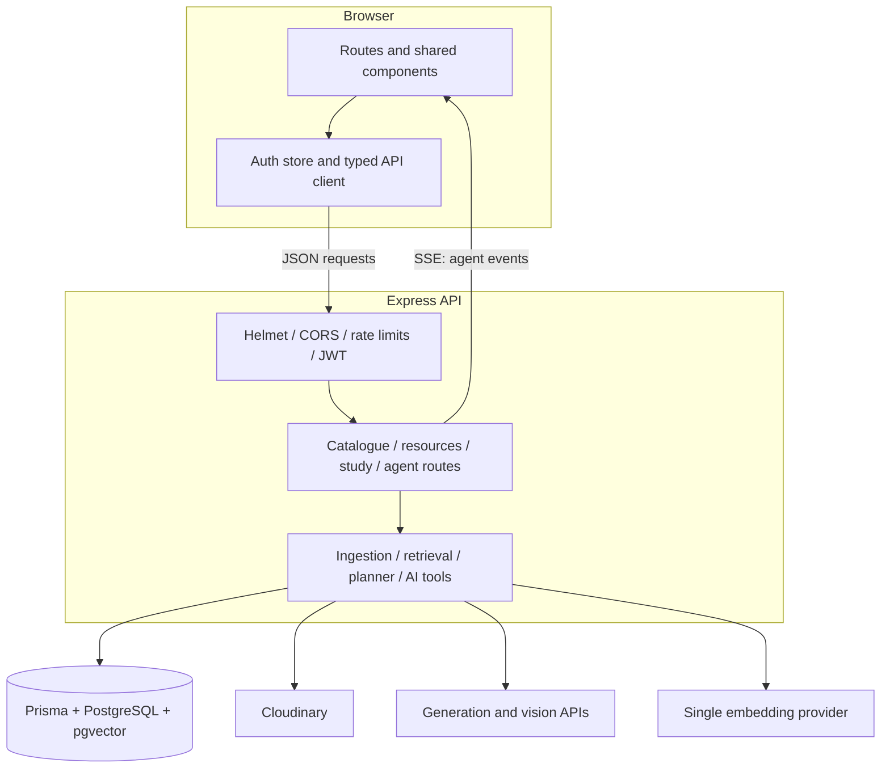
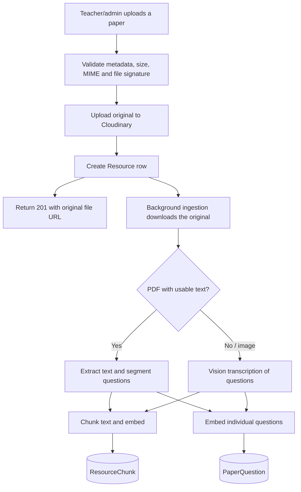
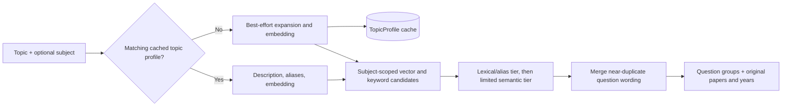
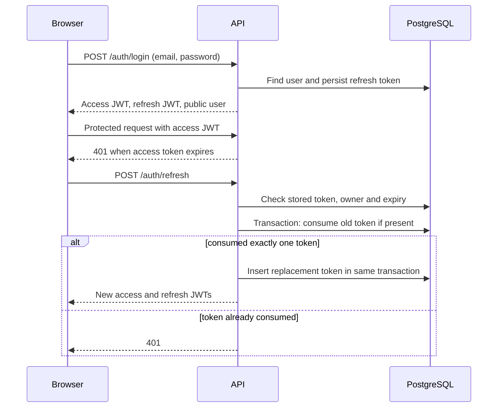
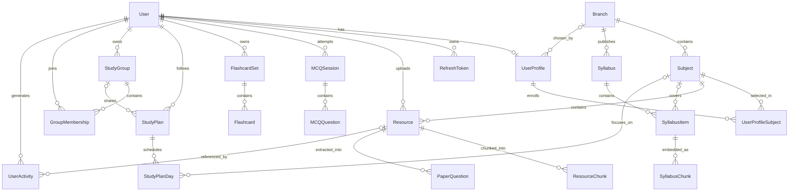

# Architecture

CampusBrain separates a server-rendered React frontend from an Express API. PostgreSQL stores accounts, academic structure, study activity and retrieval vectors; Cloudinary stores original papers. Route authorization is enforced by the API. Client-side role visibility is only a navigation convenience.

## Boundaries

The browser receives only public resource metadata or data authorized for its user. Teachers may upload and delete their own resources; admins can manage the catalogue and delete any resource. Personal study records belong to a user. Group routes verify membership or ownership before group actions.

## Ingestion: from original file to searchable evidence

Supported new uploads are PDF, PNG, JPEG and WebP, up to 25 MB. Timetable PDFs have a separate 10 MB limit. Signature checks reject unsupported or disguised content before storage; they do not prove a file is structurally valid or malware-free.

If the database insert fails after upload, the route attempts to remove the orphaned Cloudinary asset and logs a failed cleanup. Cloud storage and PostgreSQL cannot participate in one atomic transaction.

Text chunks serve retrieval-augmented generation (RAG); individual questions serve topic-wise PYQ search. Syllabus items have their own overview/topic chunks. Embeddings are computed before replacing indexed records, and indexed replacements use database transactions.

Background work is not durable: a successful upload means the original was saved, not that extraction and indexing completed. Re-run the maintenance scripts after interruptions and inspect ingestion logs.

## Retrieval: relevance before generation

A lexical/alias hit is ranked in the trusted tier. Semantic-only candidates require the configured similarity threshold (default 0.5) and are limited to three by default. Duplicate grouping preserves appearances so a repeated question still links to each source paper.

Topic profiles are standalone cached records keyed by normalized topic and subject context, with the model identifier stored alongside the vector. A search loads the complete selection with one query. Exact phrases rank ahead of other lexical matches; partial multi-word matches need at least 60% token overlap to qualify as trusted lexical evidence. Numerical and programming-language differences prevent inappropriate duplicate merging. A profile does not guarantee a question is relevant; the original paper remains the evidence.

Embedding requests share a bounded cache (512 entries, 30-minute expiry) and overlapping batches reuse in-flight requests. Query/document tasks remain distinct. Topic-frequency scoring aggregates the top matching paper chunks inside PostgreSQL, twenty topics per query, instead of returning chunk text for each topic.

Generation routes retrieve course material when a subject is supplied. The agent can invoke retrieval and study tools on behalf of the authenticated user. Quizzes and flashcards reject unusable generated content and return 503 if generation cannot produce valid material.

## Sessions and refresh rotation

The client shares one in-flight refresh request among concurrent requests. A late refresh response cannot restore a session after logout or replace a newer login. The backend validates JWT claim shapes and restricts accepted signatures to HS256. Refresh token storage remains plaintext in the database; protecting that database and backups is essential.

## Data model

This diagram shows relationships, not every column. Exact constraints and nullable fields are defined in `backend/prisma/schema.prisma`.

`TopicProfile` has no foreign-key relationships. It is a cache, not another course catalogue.

## Planning and active recall

The planner is deterministic code in `planBuilder.ts`, rather than an LLM-authored schedule. It matches timetable entries to enrolled subjects, prioritizes topics using past-paper evidence, and distributes learning and revision into daily time budgets. Calendar calculations use **Asia/Kolkata (UTC+05:30)** consistently. Partial timetable matches schedule matched subjects; zero matches in a supplied non-empty timetable produce an actionable validation error.

Each plan day stores structured sessions alongside its legacy topic list. Catch-up retains completed work and regenerates remaining days from the saved plan configuration. Group plans create a separate personal copy for each member.

Quiz scores and submitted choices are persisted in one transaction. Duplicate or foreign question IDs are rejected. Unattempted session responses omit the answer key; submission returns the result and explanations.

Flashcard reviews use SM-2 scheduling, adjusting ease, interval and next-review date from the student's quality rating.

## UI structure

`__root.tsx` owns document metadata, toast notifications and error boundaries. `_layout.tsx` supplies shared navigation for feature pages. The paper library also uses the shared Header; the animated landing page has its own navigation. File-based route types are generated; do not hand-edit `routeTree.gen.ts`.

The original visual design is retained. The header has primary learning links, secondary workspace links for signed-in users and a collapsible mobile menu. The paper library filters subjects through its search field. The sign-in overlay is implemented in `components/campus/LoginModal.tsx`; reusable Radix primitives are available under `components/ui/`.
